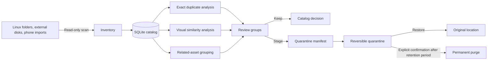
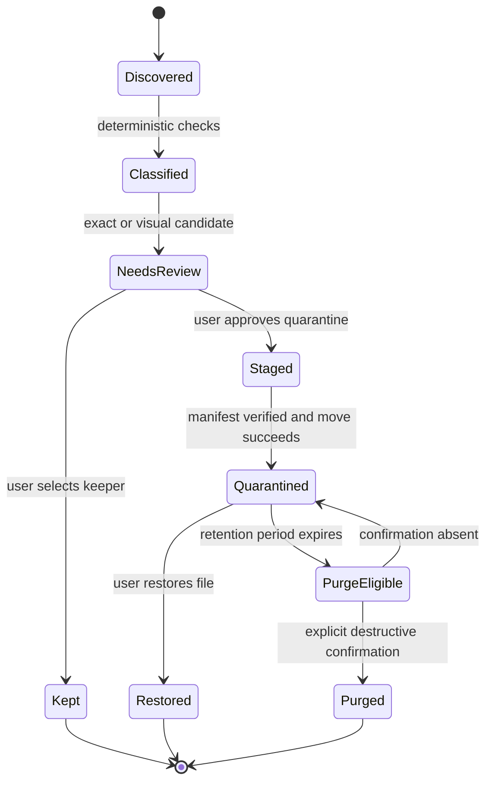
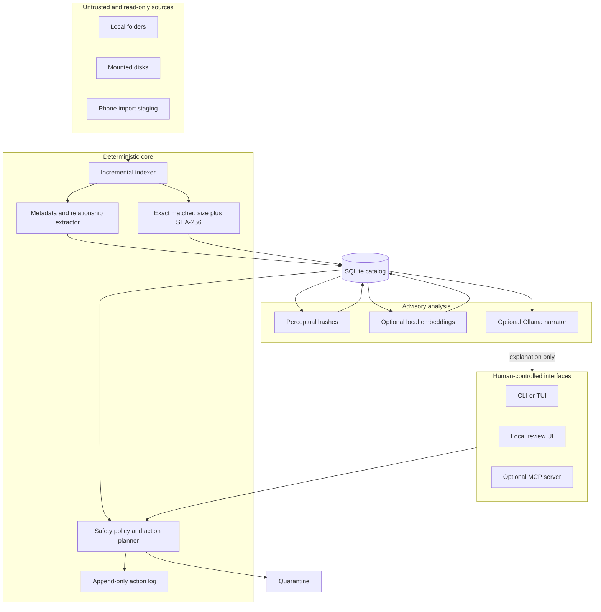

[English](README.md) · [Español](README_ES.md) · [Technical README](docs/TECHNICAL_README.md)

# Photo Custodian

Photo collections accumulate exact copies, edited exports, compressed versions,
bursts, sidecar files, and files imported repeatedly from phones and computers.
Deleting by filename or visual resemblance alone can destroy the only valuable
copy.

Photo Custodian inventories local media, finds duplicates and possible photo
versions, and generates an offline HTML report for reviewing groups. The report
records choices for later verification. Reversible quarantine and file mutation
commands are planned.

It also builds a searchable, offline archive of extracted content (OCR, PDF
text, audio/video transcripts) and can export metadata-only review leads, a
source-time timeline, and byte manifests for an authorized third party, such
as counsel in a legal matter, without the user having to reopen or re-expose
themselves to the underlying material. These exports omit filenames, excerpts
and media by default; see
[Export review leads without opening source material](#export-review-leads-without-opening-source-material).

The archive analysis workflow is implemented. End-to-end operation, hosted analysis and throughput on the 3 TB collection remain unverified.

## Run inventory and exact duplicate detection

```bash
uv sync --locked
uv run photo-custodian scan ~/Pictures /mnt/archive
uv run photo-custodian inventory
uv run photo-custodian duplicates exact
```

The default catalog is stored under the user's XDG data directory. Override it
with `--catalog /path/to/catalog.sqlite3` or `PHOTO_CUSTODIAN_CATALOG`. Scanning
reads source metadata and writes only to the catalog.

## Review the library in HTML

```bash
uv sync --locked --extra review
uv run photo-custodian scan /path/to/one/library
uv run photo-custodian report --output review-01.html
```

Open the HTML in a browser. Start with one group, compare the paths and previews,
and select the file you would keep. Download the review notes before closing
the page. You can restore them from the same report. Choices are group-scoped
and require fresh verification before any cleanup.

- **Exact copies** are groups from cached or newly computed SHA-256 evidence.
  This is a catalog snapshot. Review stale and failed scan counts before proceeding.
- **Photo versions** are candidates based on visual fingerprints, aspect ratio and
  coarse color. Compare image details yourself. The matcher is tuned for similar
  framing and works best on resizes and re-encodes. Crops, substantial edits,
  unsupported formats and video variants may be missed. Videos still participate
  in exact detection.
- **Suggested categories** are optional. Copy up to 10 photo IDs from the report
  and run a new report with `--categorize ID1 ID2` and `OPENAI_API_KEY` set.
  Each selected photo can incur one API request with a JPEG preview, 320 pixels
  on its longest side, with source metadata removed. Text visible in the photo
  remains visible to the model. The local catalog stores the suggested labels.
  Reports without `--categorize` are offline.

The first report reads media bytes. Subsequent runs reuse exact hashes and
versioned photo signatures where available. Use `--offset 25` with the default
limit to see the next set of groups, and use a fresh output filename. Report
warnings include skipped photos and incomplete analysis. An HTML report is a
review artifact that contains local paths. Add `--show-previews` to embed photo previews.

## Build a searchable content archive

Scan directories exported from an iPhone or PC, or directories on a mounted
external drive. Keep the SQLite catalog on the computer that runs Photo
Custodian. The source directory must be visible to Linux as regular files.
Use the same mount path when reconnecting a drive. Direct iPhone protocol
access is outside this intake path. Convert unsupported image formats during
export if the local decoder cannot open them.

```bash
uv sync --locked --extra review
uv run photo-custodian scan /path/to/library
uv run photo-custodian analyze --source /path/to/library
uv run photo-custodian archive --output archive-01.html
```

The analysis queue processes bounded batches and saves each file result. Run
another batch to continue. Set `--kind image`, `--kind pdf` or `--kind video`
to prioritize a type. Use `--retry-unavailable` after reconnecting a source
or restoring a missing dependency. Image text extraction uses Tesseract with
English and Spanish language data by default. PDF extraction uses Poppler's
`pdftotext` for the first six pages. Video analysis uses an FFmpeg frame
without audio. Unsupported content remains visible as pending or unavailable.
PDFs without a text layer require separate OCR.

`archive --query "search terms"` searches paths, extracted text and saved
model suggestions locally. Add `--category "Scientific papers"` to filter
saved categories and `--output search.html` for an offline review page.

Add `--openai` to `analyze` to get proposed titles, categories, useful details,
possible reasons for saving screenshots, and suggestions for future filing
rules. Each item may send a resized preview, frame, and/or bounded extracted
text to OpenAI. Text and pixels may contain private material. By default,
extraction and searching stay local. Set `OPENAI_API_KEY` for the hosted step.
PDF conclusions describe the sampled excerpt. A screenshot's saved reason
is a hypothesis.

Use `compare 12 13 14 --openai` with two to six photo IDs from the duplicate
report for a JSON keep proposal. The model can propose several photos or
abstain. Selections remain advisory.

Use `workflow --source /path/to/library --output archive-next.html` to print a
shell script for a reviewable scan, analysis batch and report. For a removable
drive, add `--mountpoint /path/to/mount` to guard the generated run against
an unmounted drive. Adding `--openai` includes hosted analysis in that script.
Set `--batches` to process multiple batches in one run. Scripts are generated
from fixed commands and user arguments.

## Register a removable Linux source

`source-register --uuid UUID --mount MOUNT --folder SUBDIRECTORY` binds a
catalog source ID to a filesystem UUID and relative folder. `source-scan ID
--mount MOUNT` scans the same source after a reconnect, including when the
mountpoint changes. The scanner pins the root directory during traversal
and stages rows in one transaction. If the attachment changes, the scan is
discarded and previously catalogued paths are retained.

Use `sources` to list catalog IDs and last recorded states without probing
devices. `analyze --source-id ID` checks the current attachment of a registered
source. `workflow --source-id ID --mountpoint MOUNT --output REVIEW.html`
prints a script for guarded scanning, bounded analysis and a metadata-only
handoff for that source. Add `--openai` or `--ollama --model MODEL` to include
explicit model analysis.

This option supports full Linux block-device mounts that expose the UUID
mapping under `/dev/disk/by-uuid`. Layouts that cannot be verified use the
existing working-copy intake. For phones or another computer, catalog an
exported working copy from the local filesystem.

## Intake Gmail and WhatsApp for private review

`intake-gmail --query QUERY --output DIRECTORY` downloads a Gmail selection
as raw EML and records message IDs and byte digests. Set `GMAIL_ACCESS_TOKEN`
using an OAuth token restricted to Gmail read-only access. Repeat the same
account, query and output directory to resume paging. Attachments remain
embedded in the original MIME messages. `stage-mail-attachments --source DIRECTORY
--output WORKING_DIRECTORY` extracts compatible attachments in resumable batches.
Each private receipt ties a MIME part and its decoded SHA-256 to the source EML
digest. The batch reports unavailable and partial messages. Scan the completed
working directory to analyze derivatives. Keep the EML folder separately.
`verify-mail-intake --source DIRECTORY` checks downloaded EML bytes against
local receipts without contacting Gmail.

`intake-whatsapp EXPORT --output DIRECTORY` stages a user-supplied ZIP or
TXT export. Its completed index links staged files and chat fragments to
the source. Keep the original export. Scan the staged directory to analyze
the copies. Large chats are split into bounded searchable text fragments.
Newly staged fragments also carry small private receipts with their own hash,
their byte range, and the declared export hash. ZIP fragments additionally
record their numbered decompressed member, so repeated member names do not
collapse into one source. Older staging directories without those receipts
remain explicitly unverified. A receipt proves a local derivative relation;
verify the original export separately with an anchored byte manifest.

`analyze --whisper-model /path/to/model.pt` enables transcription with an
installed local Whisper CLI and FFmpeg. It uses a sample of up to the first
ten minutes of each supported audio or video item. Transcript timestamps
are offsets within the media. Use `--retry-unavailable` to revisit failures
after installing tools. Email analysis extracts plain-text MIME content.
The agent can also estimate text from screenshot pixels with a vision model.
For longer recordings, use `stage-transcripts --source-id ID --whisper-model
/path/to/model.pt --output WORKING_DIRECTORY`. This resumable queue splits
the declared container duration into five-minute windows. Each receipt links
the transcript and decoded frame count to the source and model hashes. Scan
the staging directory to search transcript text. Timestamps are relative
to the decoded window. A short or silent window is recorded separately.

`archive --case-lane defense` and `archive --case-lane complaint` list
independent model-generated leads. One artifact can appear in both.
The default archive output omits excerpts and model notes.

## Locate evidence without opening media

```bash
uv run photo-custodian ask "remembered phrase"
```

The command searches recorded OCR and PDF text and returns file and source IDs,
extraction scope, excerpt offsets and a SHA-256 digest of the extracted text.
The output omits excerpts, file paths and media by default. The digest describes
the extracted text in the catalog. It does not authenticate the original file.
The reported modification timestamp comes from the catalog. Use
`archive --file-id ID` to locate a match. Add `--show-content` to include text
and model suggestions in an archive export.

For optional interpretation, use `ask "remembered phrase" --show-content
--openai`, or select `--ollama --model MODEL` instead. The provider receives the
question and selected text excerpts. The response cites reference IDs for this
query. A citation identifies the supplied excerpt and does not establish that
every model claim follows from it. A provider failure preserves local matches.

`analyze` and `compare` also accept `--ollama --model MODEL`. For images, select a
compatible vision model. For sensitive work, use an installed local model with
the running Ollama server's cloud features disabled (`OLLAMA_NO_CLOUD=1` or
`disable_ollama_cloud` in the server settings). The adapter uses
`127.0.0.1:11434` and has no automatic provider fallback.

## Export review leads without opening source material

`case-handoff --output handoff.html` produces a private, offline summary of
the two advisory review lanes and the coverage gaps. Use a new `.json` output
for the full machine-readable catalog index, or `--source-id ID` to limit scope.
The browser version caps the visible lead list. Both formats omit media,
filenames, excerpts and free-text model notes. IDs refer to this catalog.
An absent lead or incomplete extraction leaves human review open.
The report distinguishes bounded, truncated, unavailable and unknown text
coverage. Invalid per-item model responses are recorded and the queue
continues. Use `analyze --retry-triage` to revisit rejected outputs; provider
connection or authentication failures still pause the batch.

`timeline --output timeline.html` exports a private metadata timeline without
opening media or showing paths, names, excerpts, or model notes. It keeps each
catalog source as a separate clock domain and labels times as recorded
filesystem metadata, not event time. It does not establish order or causation
between sources; use an independently documented anchor before making that
comparison.

### Link mail and transcript derivatives

For catalogued attachment and transcript staging roots, analysis compares
derivative bytes with their staging records. `link-derivatives --source-id ID`
backfills links for already catalogued files without inference. Use
`--retry-unverified` to repeat incomplete checks. The JSON handoff carries
the MIME part or transcript window, derivative hash, and the parent hash
declared in the receipt. This is the last catalogued check. Verify parent
bytes separately when available. `verify-lineage-parents MANIFEST --root ROOT
--expected-sha256 DIGEST` checks a working copy and saves the result for the
next handoff. The match applies to the declared hash, at the time of reading.

## Record a working-copy byte manifest

Select catalog IDs from one working-copy source. Write the manifest to an
existing local directory outside that source. The command re-reads the files,
records each SHA-256 and refuses to publish if a selected file changed or
became unavailable.

```bash
uv run photo-custodian manifest 12 13 --output /path/to/records/selection.json
uv run photo-custodian verify-manifest /path/to/records/selection.json --root /path/to/working-copy
```

The verifier compares bytes at the same relative paths under the supplied
root. Keep the printed payload digest independently and provide it with
`--expected-sha256` to check against that reference. The manifest contains
relative filenames encoded as base64 and should be handled as private
material. It records a working-copy observation, with software timestamps
outside the sealed payload. Acquisition and custody are separate processes.

## Prepare Fracture intake

`fracture-plan MANIFEST --expected-sha256 DIGEST --case-id CASE-ID --output PLAN.json`
associates an opaque case ID with an independently anchored working-copy manifest.
Its private output lists file IDs and byte digests. Fracture's single-file
routing rules supply candidate parsers for certain file types. Other files
remain available for examiner mapping. The same manifest can support separate
case plans. Verify the working copy before any subsequent examination.

The plan is a reference index. It supplies no scores or expected verdicts to
Fracture. Mobile acquisitions and ordinary archive exports have different
coverage. See the [integration decision](docs/decisions/0010-fracture-intake.md).

## Get one next step

After scanning a folder, run `uv run photo-custodian agent` for a local
next step. With `OPENAI_API_KEY` available in your environment, run
`uv run photo-custodian agent --openai` to add a short suggestion in
Rioplatense Spanish. Use `--model` or `OPENAI_MODEL` to select another
Responses API model.

The explicit OpenAI option makes one billable request containing only
file counts and logical byte totals for images, videos, and other files.
It sends no paths, names, or media. Advice has no access to filesystem
tools. If the API fails, the CLI keeps the local next step visible and
exits with a warning. Reviewing exact duplicates still hashes same-size
candidates across the catalog. The display limit only bounds the groups shown.

## What a review looks like

Open the report to compare exact copies and likely photo versions. A version
group shows paths, dimensions, file sizes and a limited set of previews. Record
the file you would keep, download the review notes and reload them when you
return. If you want a second opinion, send a small set of selected photo IDs to
the optional vision advisor. Review notes and proposals leave source files intact.

## Mental model

Photo Custodian separates four relationships that should not share one automatic
policy:

1. **Exact duplicates** have identical bytes and a matching cryptographic digest.
2. **Visual variants** may show the same photograph after resizing, compression,
   cropping, color correction, or format conversion.
3. **Related assets** belong together but are not interchangeable, such as
   RAW+JPEG, Live Photo image+video, or image+sidecar metadata.
4. **Quality candidates** may be blurred, dark, or accidental, but quality is not
   duplication and remains a separate review concern.

## Proposed workflow



The workflow is designed to fail closed: a scan produces evidence and
candidates, not filesystem mutations.

## Safety lifecycle



Permanent deletion is the terminal state. It must never be reached directly from
detection or from a model-generated recommendation.

## Proposed architecture



The deterministic core owns consequential actions. Perceptual algorithms and
language or vision models may rank or explain candidates, but cannot authorize a
move or deletion.

## What comes next

The next milestone is a review workflow that can follow a collection across
drives and devices, resume interrupted analysis, and turn findings into a
short, actionable review queue.

1. **Intake and format coverage.** Investigate iPhone import on Linux, drive
   identity after reconnecting, HEIC, Live Photos, and sidecars. Keep related
   files associated during intake and review.
2. **Content and retrieval.** Investigate better OCR for small text and scanned
   PDFs, paper metadata with page references, more representative video
   sampling, and indexed search over extracted evidence. Improve candidate
   matching for crops, edits, and video versions.
3. **Guided review and automation.** Add persistent review queues, proposals
   with evidence links, and resumable jobs. Explore a read-only MCP interface
   for searching the catalog and inspecting review groups.
4. **Reversible cleanup.** Use explicit plans, fresh file checks, quarantine,
   restore, and an audit trail. Treat permanent deletion as a separate decision
   after retention.

Third-party libraries, tools and MCP servers are open research topics. Candidate
selection is pending.

## Repository layout

```text
photo-custodian/
├── src/photo_custodian/  # CLI, SQLite catalog, analysis and offline reports
├── tests/                # regression tests for the catalog, matching and reports
├── docs/                 # technical design and decision records
└── uv.lock               # resolved Python dependencies
```

## Non-negotiable rules

- Scans are read-only unless a separately reviewed action plan is executed.
- Exact equality requires a cryptographic content digest; names and timestamps
  are not proof.
- Similarity is a candidate signal, never deletion authority.
- Every filesystem mutation has an explicit target set, a manifest, and a
  post-action verification.
- Quarantine is the default destructive boundary; permanent deletion requires a
  second confirmation after a retention period.
- A backup counts only after a restore has been tested.
- Optional AI components degrade independently and cannot block the deterministic
  core.

The [Technical README](docs/TECHNICAL_README.md) records the deeper invariants,
trust boundaries, language decision, failure modes, and verification plan.

## Contributing

Architecture proposals should preserve the
safety contract above and include a falsifiable verification plan. Code,
comments, tests, documentation, and commit messages are written in English;
`README_ES.md` is the maintained Spanish-language entry point.

## License

Photo Custodian is licensed under the [GNU General Public License v3.0](LICENSE)
(GPL-3.0-only). The license applies to the repository's software and
accompanying documentation unless a file states otherwise.
