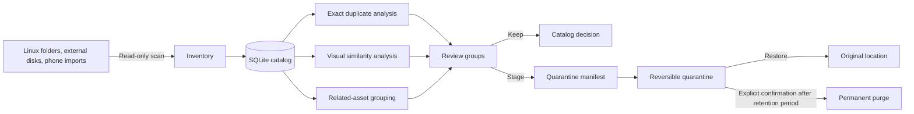
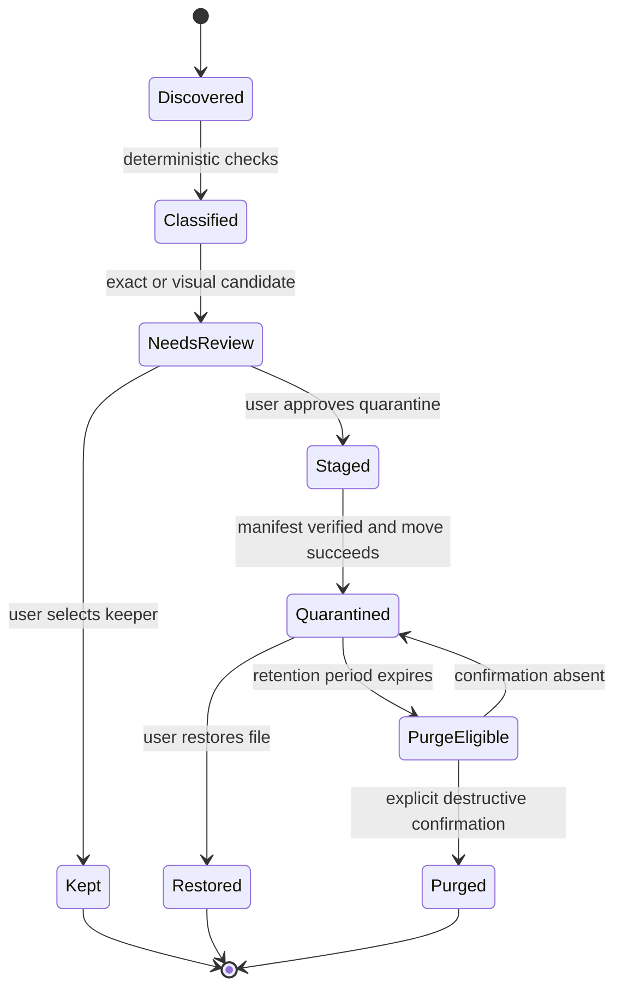
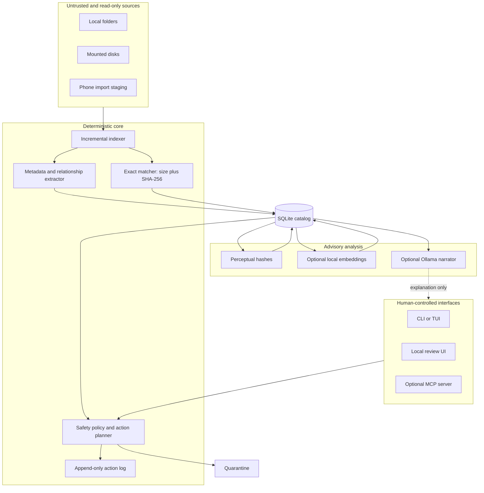

[English](README.md) · [Español](README_ES.md) · [Technical README](docs/TECHNICAL_README.md)

# Photo Custodian

Photo collections accumulate exact copies, edited exports, compressed versions,
bursts, sidecar files, and files imported repeatedly from phones and computers.
Deleting by filename or visual resemblance alone can destroy the only valuable
copy.

Photo Custodian is a planned local-first Linux tool for inventorying those
collections, identifying duplicate candidates, and moving reviewed files through
a reversible quarantine workflow. Detection and deletion are intentionally
separate operations.

> Project status: M1 exact duplicate detection is implemented. The CLI performs
> incremental inventory and complete SHA-256 verification of same-size candidates.
> Visual similarity and all filesystem mutation commands remain unimplemented.

## Run inventory and exact duplicate detection

```bash
uv sync --locked
uv run photo-custodian scan ~/Pictures /mnt/archive
uv run photo-custodian inventory
uv run photo-custodian duplicates exact
```

The default catalog is stored under the user's XDG data directory. Override it
with `--catalog /path/to/catalog.sqlite3` or `PHOTO_CUSTODIAN_CATALOG`. Scanning
reads source metadata and writes only to the catalog.

## The intended experience

```text
$ photo-custodian scan ~/Pictures /mnt/archive
Indexed: 184,212 files
Exact duplicate groups: 4,318
Visual similarity groups: 1,027
Actions performed: 0

$ photo-custodian review --group exact:0042
KEEP       /mnt/archive/2019/IMG_0042.HEIC
QUARANTINE /home/user/Pictures/import-3/IMG_0042.HEIC
Reason: identical SHA-256; keeper policy requires explicit confirmation
```

The first command observes. The second prepares a reversible action. Neither
example implies that visually similar files are safe to delete.

| Common cleanup approach | Photo Custodian's intended behavior |
|---|---|
| Treat matching filenames as duplicates | Compare content independently of names |
| Mix scanning and deletion | Separate inventory, review, quarantine, and purge |
| Let a similarity score decide | Present visual similarity as a review candidate |
| Rescan the entire library every time | Maintain an incremental local catalog |
| Ask an AI model what to delete | Keep models outside the deletion decision path |
| Report only success or failure | Distinguish confirmed, uncertain, and failed checks |

## Mental model

Photo Custodian separates four relationships that should not share one automatic
policy:

1. **Exact duplicates** have identical bytes and a matching cryptographic digest.
2. **Visual variants** may show the same photograph after resizing, compression,
   cropping, color correction, or format conversion.
3. **Related assets** belong together but are not interchangeable, such as
   RAW+JPEG, Live Photo image+video, or image+sidecar metadata.
4. **Quality candidates** may be blurred, dark, or accidental, but quality is not
   duplication and remains a separate review concern.

## Proposed workflow



The workflow is designed to fail closed: a scan produces evidence and
candidates, not filesystem mutations.

## Safety lifecycle



Permanent deletion is the terminal state. It must never be reached directly from
detection or from a model-generated recommendation.

## Proposed architecture



The deterministic core owns consequential actions. Perceptual algorithms and
language or vision models may rank or explain candidates, but cannot authorize a
move or deletion.

## Delivery plan

- **Phase 0 — Corpus and recovery:** map sources, formats, sidecars, backups, and
  a tested restore path.
- **Phase 1 — Inventory:** read-only traversal, file identity, metadata, SQLite
  schema, and resumable scans.
- **Phase 2 — Exact duplicates:** size grouping, SHA-256 verification, review
  reports, and keeper policies.
- **Phase 3 — Reversible actions:** manifests, quarantine, restore, retention,
  and an append-only audit trail.
- **Phase 4 — Visual candidates:** perceptual hashes, embeddings, thumbnails,
  and threshold evaluation against a labeled sample.
- **Phase 5 — Interfaces:** CLI/TUI first, followed by a local review UI and an
  optional capability-limited MCP server.
- **Phase 6 — Multi-device intake:** repeatable staging from a second Linux
  computer and phones without silently changing source libraries.

## Planned repository shape

```text
photo-custodian/
├── core/                    # deterministic inventory and action planning
├── adapters/                # filesystem, EXIF, image, and import boundaries
├── interfaces/              # CLI, TUI, local web UI, and optional MCP adapter
├── migrations/              # versioned SQLite schema changes
├── tests/                   # behavioral, recovery, and determinism evidence
├── docs/                    # architecture, decisions, threat model, and operations
├── README.md                # primary English introduction
└── README_ES.md             # Spanish adaptation
```

This tree is a target architecture, not a claim that the listed components have
already been implemented.

## Non-negotiable rules

- Scans are read-only unless a separately reviewed action plan is executed.
- Exact equality requires a cryptographic content digest; names and timestamps
  are not proof.
- Similarity is a candidate signal, never deletion authority.
- Every filesystem mutation has an explicit target set, a manifest, and a
  post-action verification.
- Quarantine is the default destructive boundary; permanent deletion requires a
  second confirmation after a retention period.
- A backup counts only after a restore has been tested.
- Optional AI components degrade independently and cannot block the deterministic
  core.

The [Technical README](docs/TECHNICAL_README.md) records the deeper invariants,
trust boundaries, language decision, failure modes, and verification plan.

## Contributing

The project is in its design stage. Architecture proposals should preserve the
safety contract above and include a falsifiable verification plan. Code,
comments, tests, documentation, and commit messages are written in English;
`README_ES.md` is the maintained Spanish-language entry point.

## License

No license has been selected yet. Until one is added, the repository's contents
remain under the copyright holder's default rights.
