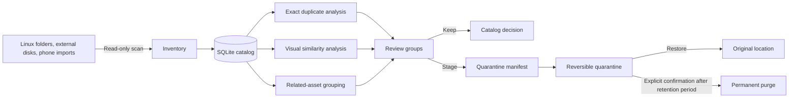
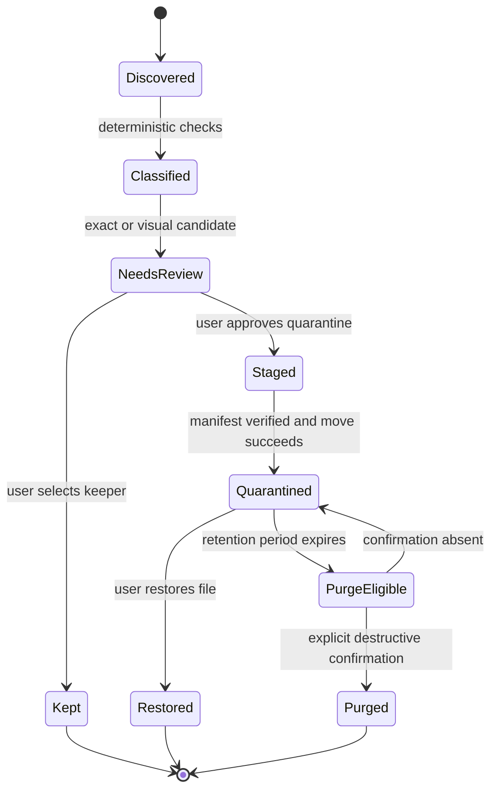
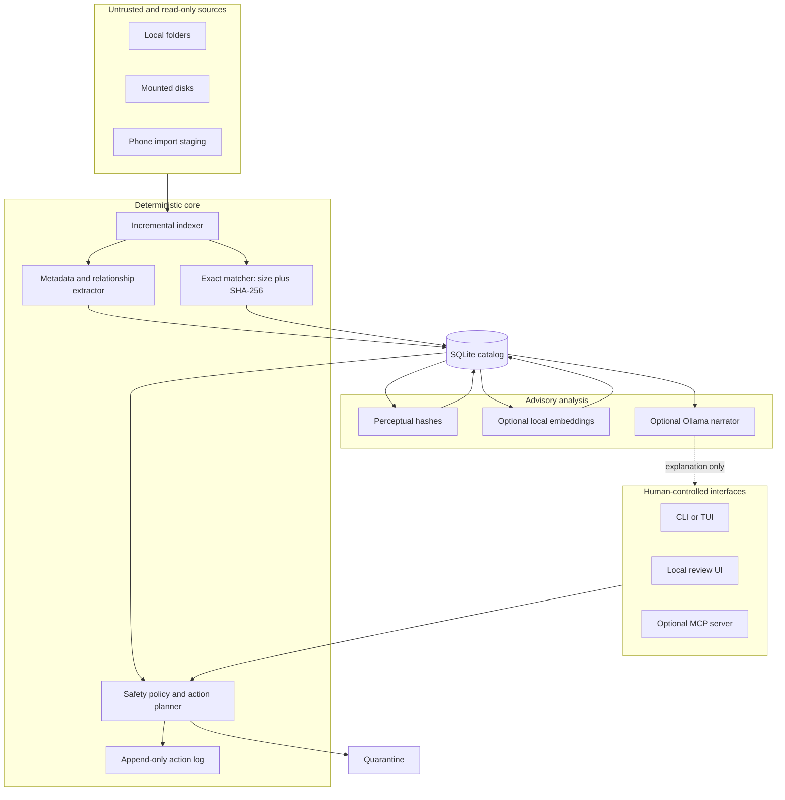

[English](README.md) · [Español](README_ES.md) · [Technical README](docs/TECHNICAL_README.md)

# Photo Custodian

Photo collections accumulate exact copies, edited exports, compressed versions,
bursts, sidecar files, and files imported repeatedly from phones and computers.
Deleting by filename or visual resemblance alone can destroy the only valuable
copy.

Photo Custodian inventories local media, finds duplicates and possible photo
versions, and generates an offline HTML report for reviewing groups. The report
records choices for later verification. Reversible quarantine and file mutation
commands are planned.

The archive analysis workflow is implemented. End-to-end operation, hosted analysis and throughput on the 3 TB collection remain unverified.

## Run inventory and exact duplicate detection

```bash
uv sync --locked
uv run photo-custodian scan ~/Pictures /mnt/archive
uv run photo-custodian inventory
uv run photo-custodian duplicates exact
```

The default catalog is stored under the user's XDG data directory. Override it
with `--catalog /path/to/catalog.sqlite3` or `PHOTO_CUSTODIAN_CATALOG`. Scanning
reads source metadata and writes only to the catalog.

## Review the library in HTML

```bash
uv sync --locked --extra review
uv run photo-custodian scan /path/to/one/library
uv run photo-custodian report --output review-01.html
```

Open the HTML in a browser. Start with one group, compare the paths and previews,
and select the file you would keep. Download the review notes before closing
the page. You can restore them from the same report. Choices are group-scoped
and require fresh verification before any cleanup.

- **Exact copies** are groups from cached or newly computed SHA-256 evidence.
  This is a catalog snapshot. Review stale and failed scan counts before proceeding.
- **Photo versions** are candidates based on visual fingerprints, aspect ratio and
  coarse color. Compare image details yourself. The matcher is tuned for similar
  framing and works best on resizes and re-encodes. Crops, substantial edits,
  unsupported formats and video variants may be missed. Videos still participate
  in exact detection.
- **Suggested categories** are optional. Copy up to 10 photo IDs from the report
  and run a new report with `--categorize ID1 ID2` and `OPENAI_API_KEY` set.
  Each selected photo can incur one API request with a JPEG preview, 320 pixels
  on its longest side, with source metadata removed. Text visible in the photo
  remains visible to the model. The local catalog stores the suggested labels.
  Reports without `--categorize` are offline.

The first report reads media bytes. Subsequent runs reuse exact hashes and
versioned photo signatures where available. Use `--offset 25` with the default
limit to see the next set of groups, and use a fresh output filename. Report
warnings include skipped photos and incomplete analysis. An HTML report is a
review artifact that contains local paths and embedded photo previews.

## Build a searchable content archive

Scan directories exported from an iPhone or PC, or directories on a mounted
external drive. Keep the SQLite catalog on the computer that runs Photo
Custodian. The source directory must be visible to Linux as regular files.
Use the same mount path when reconnecting a drive. Direct iPhone protocol
access is outside this intake path. Convert unsupported image formats during
export if the local decoder cannot open them.

```bash
uv sync --locked --extra review
uv run photo-custodian scan /path/to/library
uv run photo-custodian analyze --source /path/to/library
uv run photo-custodian archive --output archive-01.html
```

The analysis queue processes bounded batches and saves each file result. Run
another batch to continue. Set `--kind image`, `--kind pdf` or `--kind video`
to prioritize a type. Use `--retry-unavailable` after reconnecting a source
or restoring a missing dependency. Image text extraction uses Tesseract with
English and Spanish language data by default. PDF extraction uses Poppler's
`pdftotext` for the first six pages. Video analysis uses an FFmpeg frame
without audio. Unsupported content remains visible as pending or unavailable.
PDFs without a text layer require separate OCR.

`archive --query "search terms"` searches paths, extracted text and saved
model suggestions locally. Add `--category "Scientific papers"` to filter
saved categories and `--output search.html` for an offline review page.

Add `--openai` to `analyze` to get proposed titles, categories, useful details,
possible reasons for saving screenshots, and suggestions for future filing
rules. Each item may send a resized preview, frame, and/or bounded extracted
text to OpenAI. Text and pixels may contain private material. By default,
extraction and searching stay local. Set `OPENAI_API_KEY` for the hosted step.
PDF conclusions describe the sampled excerpt. A screenshot's saved reason
is a hypothesis.

Use `compare 12 13 14 --openai` with two to six photo IDs from the duplicate
report for a JSON keep proposal. The model can propose several photos or
abstain. Selections remain advisory.

Use `workflow --source /path/to/library --output archive-next.html` to print a
shell script for a reviewable scan, analysis batch and report. For a removable
drive, add `--mountpoint /path/to/mount` to guard the generated run against
an unmounted drive. Adding `--openai` includes hosted analysis in that script.
Set `--batches` to process multiple batches in one run. Scripts are generated
from fixed commands and user arguments.

## Get one next step

After scanning a folder, run `uv run photo-custodian agent` for a local
next step. With `OPENAI_API_KEY` available in your environment, run
`uv run photo-custodian agent --openai` to add a short suggestion in
Rioplatense Spanish. Use `--model` or `OPENAI_MODEL` to select another
Responses API model.

The explicit OpenAI option makes one billable request containing only
file counts and logical byte totals for images, videos, and other files.
It sends no paths, names, or media. Advice has no access to filesystem
tools. If the API fails, the CLI keeps the local next step visible and
exits with a warning. Reviewing exact duplicates still hashes same-size
candidates across the catalog. The display limit only bounds the groups shown.

## What a review looks like

Open the report to compare exact copies and likely photo versions. A version
group shows paths, dimensions, file sizes and a limited set of previews. Record
the file you would keep, download the review notes and reload them when you
return. If you want a second opinion, send a small set of selected photo IDs to
the optional vision advisor. Review notes and proposals leave source files intact.

## Mental model

Photo Custodian separates four relationships that should not share one automatic
policy:

1. **Exact duplicates** have identical bytes and a matching cryptographic digest.
2. **Visual variants** may show the same photograph after resizing, compression,
   cropping, color correction, or format conversion.
3. **Related assets** belong together but are not interchangeable, such as
   RAW+JPEG, Live Photo image+video, or image+sidecar metadata.
4. **Quality candidates** may be blurred, dark, or accidental, but quality is not
   duplication and remains a separate review concern.

## Proposed workflow



The workflow is designed to fail closed: a scan produces evidence and
candidates, not filesystem mutations.

## Safety lifecycle



Permanent deletion is the terminal state. It must never be reached directly from
detection or from a model-generated recommendation.

## Proposed architecture



The deterministic core owns consequential actions. Perceptual algorithms and
language or vision models may rank or explain candidates, but cannot authorize a
move or deletion.

## What comes next

The next milestone is a review workflow that can follow a collection across
drives and devices, resume interrupted analysis, and turn findings into a
short, actionable review queue.

1. **Intake and format coverage.** Investigate iPhone import on Linux, drive
   identity after reconnecting, HEIC, Live Photos, and sidecars. Keep related
   files associated during intake and review.
2. **Content and retrieval.** Investigate better OCR for small text and scanned
   PDFs, paper metadata with page references, more representative video
   sampling, and indexed search over extracted evidence. Improve candidate
   matching for crops, edits, and video versions.
3. **Guided review and automation.** Add persistent review queues, proposals
   with evidence links, and resumable jobs. Explore a read-only MCP interface
   for searching the catalog and inspecting review groups.
4. **Reversible cleanup.** Use explicit plans, fresh file checks, quarantine,
   restore, and an audit trail. Treat permanent deletion as a separate decision
   after retention.

Third-party libraries, tools and MCP servers are open research topics. Candidate
selection is pending.

## Repository layout

```text
photo-custodian/
├── src/photo_custodian/  # CLI, SQLite catalog, analysis and offline reports
├── tests/                # regression tests for the catalog, matching and reports
├── docs/                 # technical design and decision records
└── uv.lock               # resolved Python dependencies
```

## Non-negotiable rules

- Scans are read-only unless a separately reviewed action plan is executed.
- Exact equality requires a cryptographic content digest; names and timestamps
  are not proof.
- Similarity is a candidate signal, never deletion authority.
- Every filesystem mutation has an explicit target set, a manifest, and a
  post-action verification.
- Quarantine is the default destructive boundary; permanent deletion requires a
  second confirmation after a retention period.
- A backup counts only after a restore has been tested.
- Optional AI components degrade independently and cannot block the deterministic
  core.

The [Technical README](docs/TECHNICAL_README.md) records the deeper invariants,
trust boundaries, language decision, failure modes, and verification plan.

## Contributing

Architecture proposals should preserve the
safety contract above and include a falsifiable verification plan. Code,
comments, tests, documentation, and commit messages are written in English;
`README_ES.md` is the maintained Spanish-language entry point.

## License

No license has been selected yet. Until one is added, the repository's contents
remain under the copyright holder's default rights.
