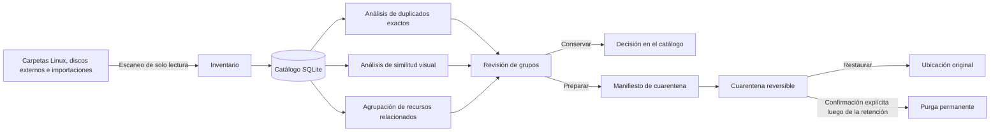
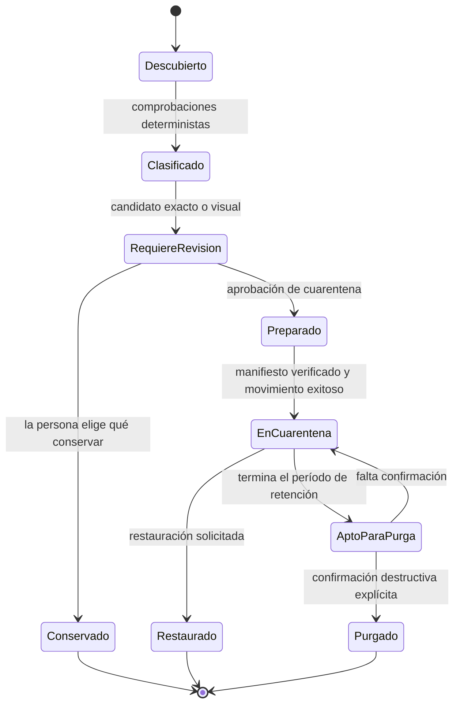
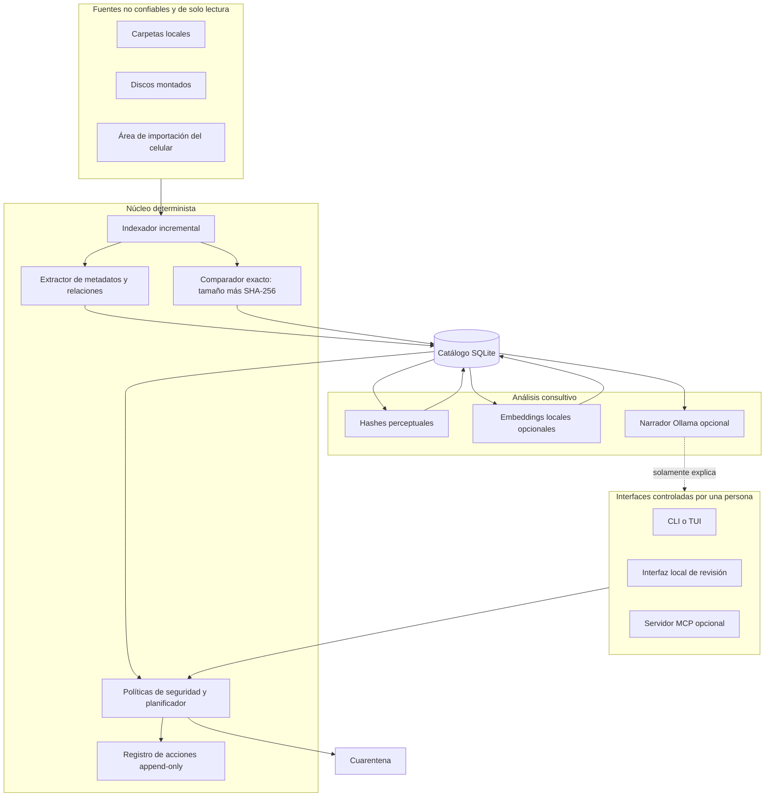

[English](README.md) · [Español](README_ES.md) · [README técnico](docs/TECHNICAL_README.md)

# Photo Custodian

Las colecciones de fotos acumulan copias exactas, exportaciones editadas,
versiones comprimidas, ráfagas, archivos auxiliares e importaciones repetidas
desde celulares y computadoras. Borrar solamente por nombre o parecido visual
puede destruir la única copia valiosa.

Photo Custodian inventaría archivos locales en Linux, agrupa duplicados y
posibles versiones de fotos, y genera reportes HTML para revisar la colección
por tandas. También crea un archivo consultable de capturas, papers y otros
contenidos compatibles. La cuarentena reversible forma parte del plan.

El flujo de análisis de contenido está implementado. Su funcionamiento integral, el análisis remoto y el rendimiento con la colección de 3 TB siguen sin verificar.

## Ejecutar inventario y duplicados exactos

```bash
uv sync --locked
uv run photo-custodian scan ~/Pictures /mnt/archive
uv run photo-custodian inventory
uv run photo-custodian duplicates exact
```

El catálogo predeterminado se guarda en el directorio de datos XDG del usuario.
Puede cambiarse con `--catalog /ruta/al/catalog.sqlite3` o con
`PHOTO_CUSTODIAN_CATALOG`. El escaneo lee metadatos de las fuentes y escribe
solamente en el catálogo.

## Revisar la biblioteca en HTML

```bash
uv sync --locked --extra review
uv run photo-custodian scan /ruta/a/una/carpeta
uv run photo-custodian report --output revision-01.html
```

- **Copias exactas.** El reporte agrupa por SHA-256 y muestra avisos de cobertura.
  Describe el estado observado durante el inventario y el análisis.
- **Posibles versiones.** El análisis visual agrupa fotos de encuadre similar,
  como reescalados y recomprimidos. Puede omitir recortes, ediciones fuertes,
  formatos incompatibles y variantes de video. Los videos sí entran en la
  detección exacta.
- **Categorías sugeridas.** Con `--categorize ID1 ID2` y `OPENAI_API_KEY` podés
  solicitar categorías para hasta diez fotos elegidas. Cada solicitud envía una
  miniatura JPEG de hasta 320 píxeles en su lado mayor, sin metadatos de origen.
  El texto visible en la imagen también puede quedar expuesto. El catálogo
  guarda las sugerencias.

El primer informe lee los archivos. Las ejecuciones siguientes reutilizan hashes
y firmas visuales cuando corresponde. Usá `--offset 25` para pasar a la siguiente
tanda con el límite predeterminado y elegí otro nombre de salida. El archivo HTML
incluye rutas y miniaturas locales.

## Crear un archivo consultable

Usá carpetas exportadas o montadas desde el iPhone, la PC o un disco externo.
Mantené el catálogo SQLite en la computadora que ejecuta Photo Custodian y
reconectá cada disco en la misma ruta. El acceso directo al iPhone y la cobertura
de HEIC quedan como líneas de investigación.

```bash
uv sync --locked --extra review
uv run photo-custodian scan /ruta/a/la/biblioteca
uv run photo-custodian analyze --source /ruta/a/la/biblioteca
uv run photo-custodian archive --output archivo-01.html
```

El análisis avanza por tandas y guarda el resultado de cada archivo. Priorizá
un tipo con `--kind image`, `--kind pdf` o `--kind video`. Usá
`--retry-unavailable` al reconectar una fuente o recuperar una dependencia.
Las imágenes usan Tesseract con datos de español e inglés. Para PDF, Poppler
extrae texto de las primeras seis páginas. Los PDF escaneados requieren OCR
aparte. FFmpeg toma un fotograma de los videos compatibles.

`archive --query "texto que recordás"` busca en rutas, texto extraído y
sugerencias guardadas. Agregá `--category "Scientific papers"` para filtrar
por categoría y `--output busqueda.html` para generar una página local.

Con `analyze --openai`, el agente puede proponer títulos, categorías,
información destacada, reglas de organización y un posible motivo para
guardar una captura. El modo optativo puede enviar una vista reducida,
un fotograma o un extracto de texto a OpenAI. La extracción y la búsqueda
predeterminadas son locales. Los resultados describen el contenido examinado.
El motivo de una captura es una hipótesis.

`compare 12 13 14 --openai` compara entre dos y seis fotos seleccionadas y
devuelve una propuesta en JSON. El agente puede recomendar conservar varias
o abstenerse.

`workflow --source /ruta/a/la/biblioteca --output archivo-siguiente.html`
genera un script revisable de escaneo, análisis y reporte. Con un disco externo,
`--mountpoint /ruta/al/montaje` agrega una comprobación de montaje.
`--batches` permite procesar varias tandas en una ejecución. Agregá
`--openai` para incluir el análisis remoto en el script.

## Obtener un próximo paso

`uv run photo-custodian agent` ofrece un próximo paso a partir del inventario.
`agent --openai` envía una solicitud con conteos y tamaños totales por tipo,
sin fotos, nombres ni rutas. Podés configurar el modelo con `--model` o
`OPENAI_MODEL`. Si falla la consulta, el próximo paso local sigue visible.

## Cómo se ve una revisión

Abrí el informe y compará copias exactas y posibles versiones. Un grupo de
versiones muestra rutas, dimensiones, tamaños y una selección de miniaturas.
Elegí el archivo que conservarías, descargá las notas y volvé a cargarlas al
retomar. Si querés una segunda opinión, seleccioná algunas fotos para el
asesor visual. Las notas y las propuestas dejan intactos los originales.

## Modelo conceptual

Photo Custodian separa cuatro relaciones que no deberían compartir una política
automática:

1. Los **duplicados exactos** tienen bytes idénticos y el mismo resumen
   criptográfico.
2. Las **variantes visuales** pueden mostrar la misma fotografía después de un
   cambio de tamaño, compresión, recorte, corrección de color o conversión.
3. Los **recursos relacionados** deben permanecer asociados, pero no son
   intercambiables: RAW+JPEG, imagen+video de una Live Photo o imagen+metadatos.
4. Los **candidatos de calidad** pueden estar desenfocados, oscuros o ser
   accidentales, pero la calidad no es duplicación y requiere otra revisión.

## Flujo propuesto



El flujo falla de manera segura: un escaneo produce evidencia y candidatos, no
mutaciones del sistema de archivos.

## Ciclo de seguridad



El borrado permanente es el estado terminal. Nunca debe alcanzarse directamente
desde la detección ni desde una recomendación generada por un modelo.

## Arquitectura propuesta



El núcleo determinista controla las acciones con consecuencias. Los algoritmos
perceptuales y los modelos de lenguaje o visión pueden ordenar o explicar
candidatos, pero no autorizar movimientos ni borrados.

## Qué sigue

El próximo hito es una revisión que pueda seguir una colección entre discos
y dispositivos, retomar análisis interrumpidos y convertir los hallazgos en una
cola corta con decisiones concretas.

1. **Ingreso y formatos.** Investigar la importación del iPhone en Linux, la
   identidad del disco al reconectarlo, HEIC, Live Photos y archivos auxiliares.
   Mantener asociados los archivos relacionados durante el ingreso y la revisión.
2. **Contenido y búsqueda.** Investigar mejor OCR para letra chica y PDF
   escaneados, metadatos de papers con referencias de página, muestras de video
   más representativas y búsqueda indexada sobre la evidencia extraída. Mejorar
   la detección de recortes, ediciones y versiones de video.
3. **Revisión guiada y automatización.** Incorporar colas persistentes,
   propuestas con enlaces a la evidencia y tareas reanudables. Explorar una
   interfaz MCP de solo lectura para consultar el catálogo y los grupos.
4. **Limpieza reversible.** Usar planes explícitos, comprobar de nuevo los
   archivos, agregar cuarentena y restauración, y registrar las acciones.
   El borrado permanente requiere una decisión posterior a la retención.

La investigación de librerías, herramientas y servidores MCP sigue abierta.
La selección de candidatos está pendiente.

## Estructura del repositorio

```text
photo-custodian/
├── src/photo_custodian/  # CLI, catálogo SQLite, análisis y reportes locales
├── tests/                # regresión de catálogo, coincidencias y reportes
├── docs/                 # diseño técnico y decisiones
└── uv.lock               # dependencias Python resueltas
```

## Reglas no negociables

- Los escaneos son de solo lectura salvo que se ejecute un plan de acción
  revisado por separado.
- La igualdad exacta exige un resumen criptográfico; los nombres y fechas no son
  prueba suficiente.
- La similitud genera candidatos, nunca autoridad de borrado.
- Cada mutación tiene un conjunto explícito de destinos, un manifiesto y una
  verificación posterior.
- La cuarentena es el límite destructivo predeterminado; el borrado permanente
  requiere una segunda confirmación después de un período de retención.
- Un backup cuenta solamente después de probar una restauración.
- Los componentes opcionales de IA se degradan independientemente y no pueden
  bloquear el núcleo determinista.

El [README técnico](docs/TECHNICAL_README.md) registra invariantes, límites de
confianza, elección de lenguajes, modos de falla y plan de verificación.

## Contribuciones

Las propuestas de arquitectura deben
preservar el contrato de seguridad e incluir un plan de verificación falsable.
El código, los comentarios, las pruebas, la documentación y los mensajes de
commit se escriben en inglés; `README_ES.md` es la entrada mantenida en español.

## Licencia

Todavía no se eligió una licencia. Hasta que se agregue una, el contenido del
repositorio conserva los derechos predeterminados de su titular.
