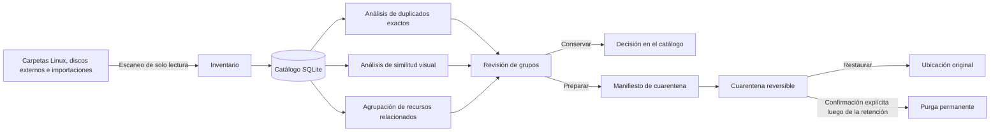
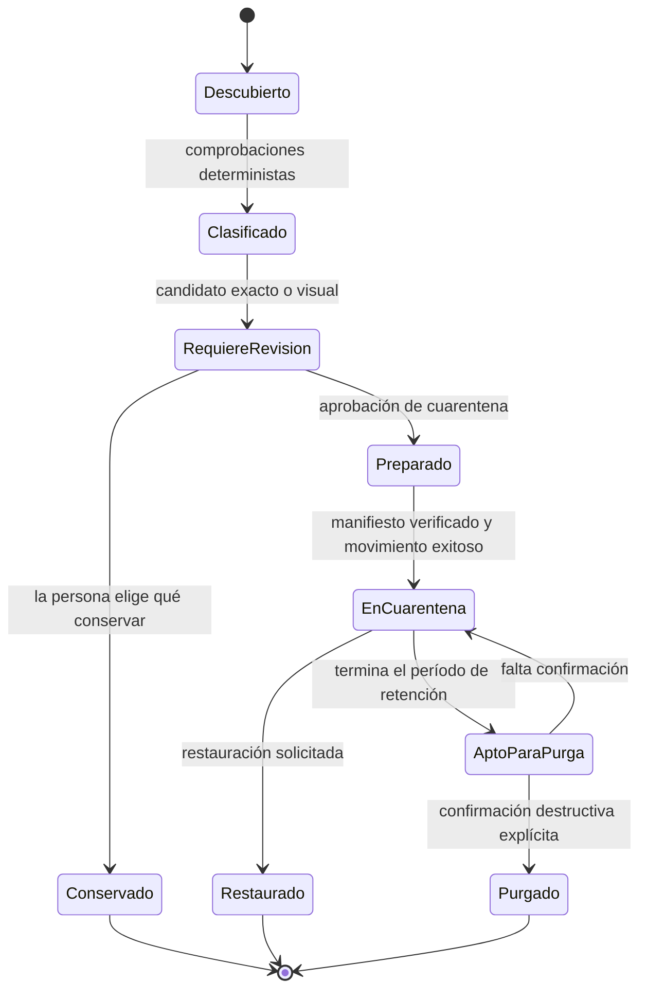
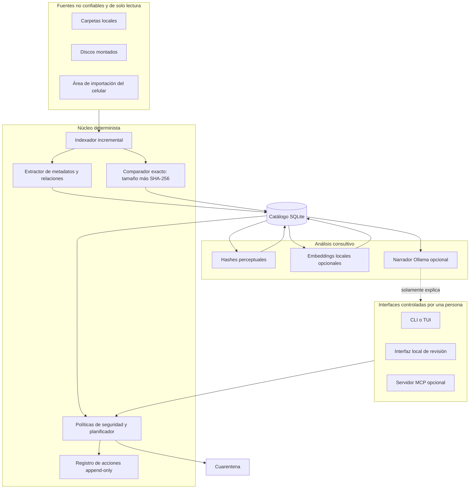

[English](README.md) · [Español](README_ES.md) · [README técnico](docs/TECHNICAL_README.md)

# Photo Custodian

Las colecciones de fotos acumulan copias exactas, exportaciones editadas,
versiones comprimidas, ráfagas, archivos auxiliares e importaciones repetidas
desde celulares y computadoras. Borrar solamente por nombre o parecido visual
puede destruir la única copia valiosa.

Photo Custodian inventaría archivos locales en Linux, agrupa duplicados y
posibles versiones de fotos, y genera reportes HTML para revisar la colección
por tandas. También crea un archivo consultable de capturas, papers y otros
contenidos compatibles. La cuarentena reversible forma parte del plan.

También puede exportar, para un tercero autorizado (por ejemplo la abogada de
un caso), referencias de revisión, una línea de tiempo de metadatos y
manifiestos de bytes, sin que la persona usuaria tenga que volver a abrir ni
exponerse al material original. Estas exportaciones omiten nombres de
archivo, extractos y contenido multimedia por defecto; ver
[Preparar una entrega sin abrir el material](#preparar-una-entrega-sin-abrir-el-material).

El flujo de análisis de contenido está implementado. Su funcionamiento integral, el análisis remoto y el rendimiento con la colección de 3 TB siguen sin verificar.

## Ejecutar inventario y duplicados exactos

```bash
uv sync --locked
uv run photo-custodian scan ~/Pictures /mnt/archive
uv run photo-custodian inventory
uv run photo-custodian duplicates exact
```

El catálogo predeterminado se guarda en el directorio de datos XDG del usuario.
Puede cambiarse con `--catalog /ruta/al/catalog.sqlite3` o con
`PHOTO_CUSTODIAN_CATALOG`. El escaneo lee metadatos de las fuentes y escribe
solamente en el catálogo.

## Revisar la biblioteca en HTML

```bash
uv sync --locked --extra review
uv run photo-custodian scan /ruta/a/una/carpeta
uv run photo-custodian report --output revision-01.html
```

- **Copias exactas.** El reporte agrupa por SHA-256 y muestra avisos de cobertura.
  Describe el estado observado durante el inventario y el análisis.
- **Posibles versiones.** El análisis visual agrupa fotos de encuadre similar,
  como reescalados y recomprimidos. Puede omitir recortes, ediciones fuertes,
  formatos incompatibles y variantes de video. Los videos sí entran en la
  detección exacta.
- **Categorías sugeridas.** Con `--categorize ID1 ID2` y `OPENAI_API_KEY` podés
  solicitar categorías para hasta diez fotos elegidas. Cada solicitud envía una
  miniatura JPEG de hasta 320 píxeles en su lado mayor, sin metadatos de origen.
  El texto visible en la imagen también puede quedar expuesto. El catálogo
  guarda las sugerencias.

El primer informe lee los archivos. Las ejecuciones siguientes reutilizan hashes
y firmas visuales cuando corresponde. Usá `--offset 25` para pasar a la siguiente
tanda con el límite predeterminado y elegí otro nombre de salida. El archivo HTML
incluye rutas locales. Agregá `--show-previews` para incluir miniaturas.

## Crear un archivo consultable

Usá carpetas exportadas o montadas desde el iPhone, la PC o un disco externo.
Mantené el catálogo SQLite en la computadora que ejecuta Photo Custodian y
reconectá cada disco en la misma ruta. El acceso directo al iPhone y la cobertura
de HEIC quedan como líneas de investigación.

```bash
uv sync --locked --extra review
uv run photo-custodian scan /ruta/a/la/biblioteca
uv run photo-custodian analyze --source /ruta/a/la/biblioteca
uv run photo-custodian archive --output archivo-01.html
```

El análisis avanza por tandas y guarda el resultado de cada archivo. Priorizá
un tipo con `--kind image`, `--kind pdf` o `--kind video`. Usá
`--retry-unavailable` al reconectar una fuente o recuperar una dependencia.

Antes de extraer o enviar contenido a un modelo, cada ítem se hashea con el
mismo SHA-256 completo que usan los duplicados exactos. Si ya existe una copia
con bytes idénticos ya extraída o ya evaluada por el modelo, su resultado se
copia localmente y se saltea tanto la extracción como cualquier llamada al
modelo para ese ítem; la copia registra de qué ID de catálogo se reutilizó.
Es una verificación determinística y local — nunca adivina por tamaño o
nombre — así que solo aplica a bytes probadamente idénticos, y significa que
una foto o grabación duplicada nunca se vuelve a leer, transcribir ni enviar
a un proveedor una vez que una copia ya fue procesada. Las imágenes usan Tesseract con datos de español e inglés. Para PDF, Poppler
extrae texto de las primeras seis páginas. Los PDF escaneados requieren OCR
aparte. FFmpeg toma un fotograma de los videos compatibles.

`archive --query "texto que recordás"` busca en rutas, texto extraído y
sugerencias guardadas. Agregá `--category "Scientific papers"` para filtrar
por categoría y `--output busqueda.html` para generar una página local.

Con `analyze --openai`, el agente puede proponer títulos, categorías,
información destacada, reglas de organización y un posible motivo para
guardar una captura. El modo optativo puede enviar una vista reducida,
un fotograma o un extracto de texto a OpenAI. La extracción y la búsqueda
predeterminadas son locales. Los resultados describen el contenido examinado.
El motivo de una captura es una hipótesis.

`compare 12 13 14 --openai` compara entre dos y seis fotos seleccionadas y
devuelve una propuesta en JSON. El agente puede recomendar conservar varias
o abstenerse.

`workflow --source /ruta/a/la/biblioteca --output archivo-siguiente.html`
genera un script revisable de escaneo, análisis y reporte. Con un disco externo,
`--mountpoint /ruta/al/montaje` agrega una comprobación de montaje.
`--batches` permite procesar varias tandas en una ejecución. Agregá
`--openai` para incluir el análisis remoto en el script.

## Registrar un disco externo en Linux

`source-register --uuid UUID --mount MONTAJE --folder SUBCARPETA` vincula un
ID del catálogo con el UUID del sistema de archivos y una carpeta relativa.
`source-scan ID --mount MONTAJE` permite retomar la misma fuente al
reconectarla, aunque cambie la ruta. El escaneo mantiene abierta la raíz y
agrupa las escrituras en una transacción. Si cambia el montaje, descarta ese
escaneo y conserva las rutas catalogadas.

Usá `sources` para consultar IDs y últimos estados registrados sin inspeccionar
los dispositivos. `analyze --source-id ID` comprueba el montaje de una fuente
registrada. `workflow --source-id ID --mountpoint MONTAJE --output REVISION.html`
genera un script para escanear con esa comprobación, analizar por tandas y
crear una entrega de solo referencias y cobertura. Agregá `--openai` o
`--ollama --model MODELO` si querés incluir análisis por modelo.

Este modo sirve para montajes completos de dispositivos de bloque en Linux
cuyo UUID se pueda identificar en `/dev/disk/by-uuid`. Para celulares, otra
compu o montajes incompatibles, el flujo de entrada usa una copia de trabajo
exportada y accesible desde el sistema de archivos local.

## Incorporar Gmail y WhatsApp para revisión privada

`intake-gmail --query CONSULTA --output CARPETA` descarga una selección de
Gmail como EML crudo y registra IDs y hashes. Configurá `GMAIL_ACCESS_TOKEN`
con un token OAuth limitado a lectura de Gmail. Repetí la cuenta, consulta y
carpeta para retomar la descarga. Los adjuntos quedan dentro del MIME original.
`stage-mail-attachments --source CARPETA --output COPIA_DE_TRABAJO` extrae los
adjuntos compatibles por tandas reanudables. Cada registro privado vincula
la parte MIME y su SHA-256 decodificado con el hash del EML de origen. El
comando informa los correos inaccesibles o parciales. Escaneá la carpeta de
trabajo para analizar los derivados y conservá aparte los EML.
`verify-mail-intake --source CARPETA` comprueba los EML descargados contra
sus registros locales, sin conexión a Gmail.

`intake-whatsapp EXPORTACION --output CARPETA` prepara una copia de trabajo
a partir de un ZIP o TXT exportado. El índice final vincula los archivos y
fragmentos con su fuente. Conservá el export original. Escaneá la carpeta
preparada para analizar las copias. Los chats largos se dividen en fragmentos
buscables de tamaño acotado. Los fragmentos nuevos además llevan registros
privados pequeños con su hash, rango de bytes y el hash declarado del export.
En ZIP, también identifican el miembro descomprimido por número para que dos
miembros con el mismo nombre no se confundan. Las carpetas anteriores sin
esos registros quedan explícitamente sin verificar. El registro prueba una
relación local de derivación; cotejá el export original por separado con un
manifiesto de bytes anclado.

`analyze --whisper-model /ruta/modelo.pt` habilita transcripción con Whisper
local y FFmpeg ya instalados. Procesa hasta los primeros diez minutos de cada
audio o video compatible. Las marcas de tiempo son posiciones dentro del
medio. Usá `--retry-unavailable` para retomar fallas tras instalar herramientas.
En correo se extrae el cuerpo MIME de texto plano. Con un modelo visual, el
agente también puede estimar texto directamente desde una captura.

Para grabaciones largas, `stage-transcripts --source-id ID --whisper-model
/ruta/modelo.pt --output COPIA_DE_TRABAJO` transcribe por ventanas de cinco
minutos sobre la duración declarada del archivo. La cola se puede retomar.
Cada registro vincula la transcripción y las muestras decodificadas con los
hashes de la fuente y del modelo. Escaneá la carpeta de trabajo para buscar
en las transcripciones. Los tiempos son relativos a cada ventana decodificada.
Los tramos cortos o sin habla quedan identificados.

`archive --case-lane defense` y `archive --case-lane complaint` filtran
hallazgos propuestos por el modelo. Un archivo puede aparecer en ambos.
La salida predeterminada omite fragmentos y notas del modelo.

## Localizar evidencia sin abrir archivos

```bash
uv run photo-custodian ask "frase que recordás"
```

El comando busca en el OCR y el texto PDF guardados. Devuelve IDs de archivo y
fuente, el alcance de la extracción, las posiciones del fragmento y un SHA-256
del texto extraído. La salida predeterminada omite fragmentos, rutas e imágenes.
El hash identifica el texto guardado en el catálogo. La fecha de modificación
también proviene del catálogo. Usá `archive --file-id ID` para ubicar el
archivo y agregá `--show-content` para incluir texto y sugerencias en la salida.

Para solicitar una interpretación, usá `ask "frase que recordás" --show-content
--openai` o elegí `--ollama --model MODELO`. El proveedor recibe la pregunta y
fragmentos seleccionados. La respuesta cita los IDs de esa consulta. Una cita
permite ubicar el fragmento que recibió el modelo. Si el proveedor falla, las
coincidencias locales siguen disponibles.

`analyze` y `compare` también aceptan `--ollama --model MODELO`. Para imágenes,
elegí un modelo visual compatible. Con material sensible, usá un modelo local
ya instalado y deshabilitá la nube en el servidor de Ollama
(`OLLAMA_NO_CLOUD=1` o `disable_ollama_cloud` en su configuración).
El adaptador se conecta a `127.0.0.1:11434` y mantiene el proveedor elegido.

## Preparar una entrega sin abrir el material

`case-handoff --output entrega.html` genera un resumen privado y sin conexión
con las dos líneas propuestas y la cobertura del análisis. Usá una salida nueva
`.json` para el índice completo o `--source-id ID` para acotar las fuentes.
El HTML limita la cantidad de referencias visibles. Los dos formatos omiten
medios, nombres, fragmentos y notas del modelo. Los IDs pertenecen al catálogo
que generó la entrega. Una extracción incompleta o sin propuesta deja abierta
la revisión humana. El informe distingue muestras acotadas, texto recortado,
extracción no disponible y cobertura desconocida. Si el modelo devuelve una
respuesta inválida para un archivo, la cola registra el rechazo y sigue.
`analyze --retry-triage` permite revisar esos casos de nuevo. Una falla de
conexión o autenticación del proveedor pausa el lote.

`timeline --output cronologia.html` exporta una cronología privada de metadatos
sin abrir medios ni mostrar rutas, nombres, fragmentos o notas del modelo.
Conserva cada fuente como un dominio de reloj separado y etiqueta las fechas
como metadatos registrados por el sistema de archivos, no como fecha de un
hecho. No establece orden ni causalidad entre fuentes: para eso hace falta un
ancla independiente documentada.

### Vincular adjuntos y transcripciones con su origen

En carpetas de adjuntos y transcripciones ya catalogadas, el análisis coteja
los bytes del derivado con su registro. `link-derivatives --source-id ID`
completa los vínculos de archivos ya catalogados sin usar un modelo.
`--retry-unverified` permite repetir verificaciones incompletas. La entrega
JSON incluye la parte MIME o ventana transcripta, el hash del derivado y el
hash del archivo padre declarado en el registro. Refleja el último cotejo
guardado. `verify-lineage-parents MANIFIESTO --root RAIZ --expected-sha256
DIGEST` coteja los bytes de una copia de trabajo y registra el resultado para
la próxima entrega. La coincidencia se refiere al hash declarado y al momento
de la lectura.

## Registrar un manifiesto de la copia de trabajo

Seleccioná IDs del catálogo que pertenezcan a una misma copia de trabajo.
Guardá el manifiesto en un directorio local existente fuera de esa fuente.
El comando vuelve a leer cada archivo, registra su SHA-256 y cancela la
publicación si algún archivo seleccionado cambió o está inaccesible.

```bash
uv run photo-custodian manifest 12 13 --output /ruta/a/registros/seleccion.json
uv run photo-custodian verify-manifest /ruta/a/registros/seleccion.json --root /ruta/a/copia-de-trabajo
```

El verificador compara los bytes en las mismas rutas relativas bajo la raíz
indicada. Guardá el digest impreso por separado y pasalo con
`--expected-sha256` para comprobarlo contra esa referencia. El manifiesto
contiene nombres relativos codificados en base64 y se maneja como material
privado. Registra una observación sobre la copia de trabajo. Las fechas del
programa quedan fuera del contenido sellado. La adquisición y la custodia
son procesos separados.

## Preparar el ingreso a Fracture

`fracture-plan MANIFIESTO --expected-sha256 DIGEST --case-id ID --output PLAN.json`
asocia un identificador opaco de causa con un manifiesto de copia de trabajo
cuyo digest se conservó por separado. El plan privado lista IDs y hashes.
Algunos formatos reciben una sugerencia de parser según cómo Fracture enruta
archivos individuales. Los demás quedan disponibles para que se determine su
tratamiento. Un mismo manifiesto puede respaldar planes de causas distintas.
Verificá la copia de trabajo antes de cualquier examen posterior.

El plan sirve como índice de referencias. Los puntajes y el veredicto quedan
en el flujo de Fracture. Las exportaciones corrientes y las adquisiciones
móviles tienen coberturas distintas. [Decisión técnica](docs/decisions/0010-fracture-intake.md)

## Obtener un próximo paso

`uv run photo-custodian agent` ofrece un próximo paso a partir del inventario.
`agent --openai` envía una solicitud con conteos y tamaños totales por tipo,
sin fotos, nombres ni rutas. Podés configurar el modelo con `--model` o
`OPENAI_MODEL`. Si falla la consulta, el próximo paso local sigue visible.

## Cómo se ve una revisión

Abrí el informe y compará copias exactas y posibles versiones. Un grupo de
versiones muestra rutas, dimensiones, tamaños y una selección de miniaturas.
Elegí el archivo que conservarías, descargá las notas y volvé a cargarlas al
retomar. Si querés una segunda opinión, seleccioná algunas fotos para el
asesor visual. Las notas y las propuestas dejan intactos los originales.

## Modelo conceptual

Photo Custodian separa cuatro relaciones que no deberían compartir una política
automática:

1. Los **duplicados exactos** tienen bytes idénticos y el mismo resumen
   criptográfico.
2. Las **variantes visuales** pueden mostrar la misma fotografía después de un
   cambio de tamaño, compresión, recorte, corrección de color o conversión.
3. Los **recursos relacionados** deben permanecer asociados, pero no son
   intercambiables: RAW+JPEG, imagen+video de una Live Photo o imagen+metadatos.
4. Los **candidatos de calidad** pueden estar desenfocados, oscuros o ser
   accidentales, pero la calidad no es duplicación y requiere otra revisión.

## Flujo propuesto



El flujo falla de manera segura: un escaneo produce evidencia y candidatos, no
mutaciones del sistema de archivos.

## Ciclo de seguridad



El borrado permanente es el estado terminal. Nunca debe alcanzarse directamente
desde la detección ni desde una recomendación generada por un modelo.

## Arquitectura propuesta



El núcleo determinista controla las acciones con consecuencias. Los algoritmos
perceptuales y los modelos de lenguaje o visión pueden ordenar o explicar
candidatos, pero no autorizar movimientos ni borrados.

## Qué sigue

El próximo hito es una revisión que pueda seguir una colección entre discos
y dispositivos, retomar análisis interrumpidos y convertir los hallazgos en una
cola corta con decisiones concretas.

1. **Ingreso y formatos.** Investigar la importación del iPhone en Linux, la
   identidad del disco al reconectarlo, HEIC, Live Photos y archivos auxiliares.
   Mantener asociados los archivos relacionados durante el ingreso y la revisión.
2. **Contenido y búsqueda.** Investigar mejor OCR para letra chica y PDF
   escaneados, metadatos de papers con referencias de página, muestras de video
   más representativas y búsqueda indexada sobre la evidencia extraída. Mejorar
   la detección de recortes, ediciones y versiones de video.
3. **Revisión guiada y automatización.** Incorporar colas persistentes,
   propuestas con enlaces a la evidencia y tareas reanudables. Explorar una
   interfaz MCP de solo lectura para consultar el catálogo y los grupos.
4. **Limpieza reversible.** Usar planes explícitos, comprobar de nuevo los
   archivos, agregar cuarentena y restauración, y registrar las acciones.
   El borrado permanente requiere una decisión posterior a la retención.

La investigación de librerías, herramientas y servidores MCP sigue abierta.
La selección de candidatos está pendiente.

## Estructura del repositorio

```text
photo-custodian/
├── src/photo_custodian/  # CLI, catálogo SQLite, análisis y reportes locales
├── tests/                # regresión de catálogo, coincidencias y reportes
├── docs/                 # diseño técnico y decisiones
└── uv.lock               # dependencias Python resueltas
```

## Reglas no negociables

- Los escaneos son de solo lectura salvo que se ejecute un plan de acción
  revisado por separado.
- La igualdad exacta exige un resumen criptográfico; los nombres y fechas no son
  prueba suficiente.
- La similitud genera candidatos, nunca autoridad de borrado.
- Cada mutación tiene un conjunto explícito de destinos, un manifiesto y una
  verificación posterior.
- La cuarentena es el límite destructivo predeterminado; el borrado permanente
  requiere una segunda confirmación después de un período de retención.
- Un backup cuenta solamente después de probar una restauración.
- Los componentes opcionales de IA se degradan independientemente y no pueden
  bloquear el núcleo determinista.

El [README técnico](docs/TECHNICAL_README.md) registra invariantes, límites de
confianza, elección de lenguajes, modos de falla y plan de verificación.

## Contribuciones

Las propuestas de arquitectura deben
preservar el contrato de seguridad e incluir un plan de verificación falsable.
El código, los comentarios, las pruebas, la documentación y los mensajes de
commit se escriben en inglés; `README_ES.md` es la entrada mantenida en español.

## Licencia

Photo Custodian está licenciado bajo la [GNU General Public License v3.0](LICENSE)
(GPL-3.0-only). La licencia se aplica al software y a la documentación del
repositorio, salvo que un archivo indique lo contrario.
