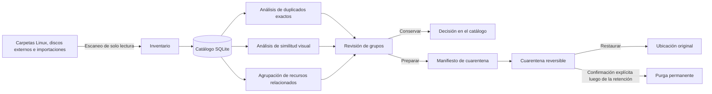
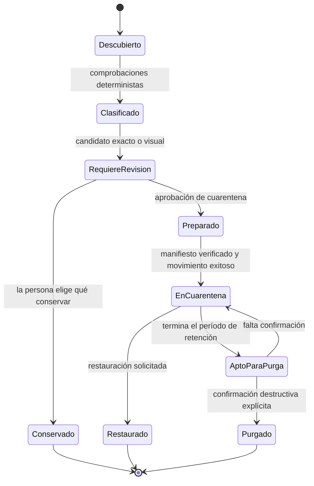
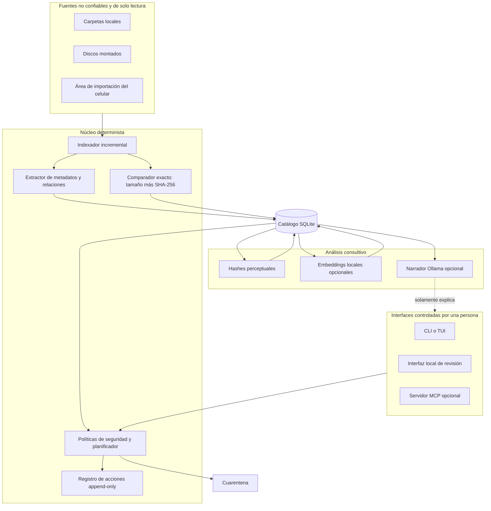

[English](README.md) · [Español](README_ES.md) · [README técnico](docs/TECHNICAL_README.md)

# Photo Custodian

Las colecciones de fotos acumulan copias exactas, exportaciones editadas,
versiones comprimidas, ráfagas, archivos auxiliares e importaciones repetidas
desde celulares y computadoras. Borrar solamente por nombre o parecido visual
puede destruir la única copia valiosa.

Photo Custodian es una herramienta local para Linux, actualmente en etapa de
diseño, que inventariará esas colecciones, identificará candidatos duplicados y
moverá archivos revisados mediante una cuarentena reversible. La detección y el
borrado son operaciones deliberadamente separadas.

> Estado del proyecto: la detección de duplicados exactos M1 está implementada.
> La CLI inventaría incrementalmente y verifica candidatos del mismo tamaño con
> SHA-256 completo. La similitud visual y las mutaciones siguen sin implementar.

## Ejecutar inventario y duplicados exactos

```bash
uv sync --locked
uv run photo-custodian scan ~/Pictures /mnt/archive
uv run photo-custodian inventory
uv run photo-custodian duplicates exact
```

El catálogo predeterminado se guarda en el directorio de datos XDG del usuario.
Puede cambiarse con `--catalog /ruta/al/catalog.sqlite3` o con
`PHOTO_CUSTODIAN_CATALOG`. El escaneo lee metadatos de las fuentes y escribe
solamente en el catálogo.

## La experiencia propuesta

```text
$ photo-custodian scan ~/Pictures /mnt/archive
Indexed: 184,212 files
Exact duplicate groups: 4,318
Visual similarity groups: 1,027
Actions performed: 0

$ photo-custodian review --group exact:0042
KEEP       /mnt/archive/2019/IMG_0042.HEIC
QUARANTINE /home/user/Pictures/import-3/IMG_0042.HEIC
Reason: identical SHA-256; keeper policy requires explicit confirmation
```

El primer comando observa. El segundo prepara una acción reversible. Ninguno de
los ejemplos implica que sea seguro borrar archivos solamente por parecerse.

| Limpieza habitual | Comportamiento propuesto de Photo Custodian |
|---|---|
| Trata nombres iguales como duplicados | Compara contenido independientemente del nombre |
| Mezcla escaneo y borrado | Separa inventario, revisión, cuarentena y purga |
| Deja que un puntaje decida | Presenta la similitud visual como candidata a revisión |
| Reescanea toda la biblioteca siempre | Mantiene un catálogo local incremental |
| Pregunta a una IA qué borrar | Mantiene los modelos fuera de la decisión de borrado |
| Informa solamente éxito o error | Distingue comprobaciones confirmadas, inciertas y fallidas |

## Modelo conceptual

Photo Custodian separa cuatro relaciones que no deberían compartir una política
automática:

1. Los **duplicados exactos** tienen bytes idénticos y el mismo resumen
   criptográfico.
2. Las **variantes visuales** pueden mostrar la misma fotografía después de un
   cambio de tamaño, compresión, recorte, corrección de color o conversión.
3. Los **recursos relacionados** deben permanecer asociados, pero no son
   intercambiables: RAW+JPEG, imagen+video de una Live Photo o imagen+metadatos.
4. Los **candidatos de calidad** pueden estar desenfocados, oscuros o ser
   accidentales, pero la calidad no es duplicación y requiere otra revisión.

## Flujo propuesto



El flujo falla de manera segura: un escaneo produce evidencia y candidatos, no
mutaciones del sistema de archivos.

## Ciclo de seguridad



El borrado permanente es el estado terminal. Nunca debe alcanzarse directamente
desde la detección ni desde una recomendación generada por un modelo.

## Arquitectura propuesta



El núcleo determinista controla las acciones con consecuencias. Los algoritmos
perceptuales y los modelos de lenguaje o visión pueden ordenar o explicar
candidatos, pero no autorizar movimientos ni borrados.

## Plan de entrega

- **Fase 0 — Corpus y recuperación:** mapear fuentes, formatos, archivos
  auxiliares, backups y un camino de restauración probado.
- **Fase 1 — Inventario:** recorrido de solo lectura, identidad de archivos,
  metadatos, esquema SQLite y escaneos reanudables.
- **Fase 2 — Duplicados exactos:** agrupación por tamaño, verificación SHA-256,
  informes de revisión y políticas para elegir qué conservar.
- **Fase 3 — Acciones reversibles:** manifiestos, cuarentena, restauración,
  retención y registro append-only.
- **Fase 4 — Candidatos visuales:** hashes perceptuales, embeddings, miniaturas y
  evaluación de umbrales contra una muestra etiquetada.
- **Fase 5 — Interfaces:** primero CLI/TUI; después interfaz web local y servidor
  MCP opcional con capacidades limitadas.
- **Fase 6 — Ingreso desde varios dispositivos:** staging repetible desde otra
  computadora Linux y celulares sin modificar silenciosamente las bibliotecas.

## Estructura prevista

```text
photo-custodian/
├── core/                    # inventario determinista y planificación de acciones
├── adapters/                # límites de filesystem, EXIF, imágenes e importación
├── interfaces/              # CLI, TUI, web local y adaptador MCP opcional
├── migrations/              # cambios versionados del esquema SQLite
├── tests/                   # evidencia de comportamiento, recuperación y determinismo
├── docs/                    # arquitectura, decisiones, amenazas y operación
├── README.md                # introducción principal en inglés
└── README_ES.md             # adaptación en español
```

Esta estructura es una arquitectura objetivo, no una afirmación de que sus
componentes ya estén implementados.

## Reglas no negociables

- Los escaneos son de solo lectura salvo que se ejecute un plan de acción
  revisado por separado.
- La igualdad exacta exige un resumen criptográfico; los nombres y fechas no son
  prueba suficiente.
- La similitud genera candidatos, nunca autoridad de borrado.
- Cada mutación tiene un conjunto explícito de destinos, un manifiesto y una
  verificación posterior.
- La cuarentena es el límite destructivo predeterminado; el borrado permanente
  requiere una segunda confirmación después de un período de retención.
- Un backup cuenta solamente después de probar una restauración.
- Los componentes opcionales de IA se degradan independientemente y no pueden
  bloquear el núcleo determinista.

El [README técnico](docs/TECHNICAL_README.md) registra invariantes, límites de
confianza, elección de lenguajes, modos de falla y plan de verificación.

## Contribuciones

El proyecto está en etapa de diseño. Las propuestas de arquitectura deben
preservar el contrato de seguridad e incluir un plan de verificación falsable.
El código, los comentarios, las pruebas, la documentación y los mensajes de
commit se escriben en inglés; `README_ES.md` es la entrada mantenida en español.

## Licencia

Todavía no se eligió una licencia. Hasta que se agregue una, el contenido del
repositorio conserva los derechos predeterminados de su titular.
