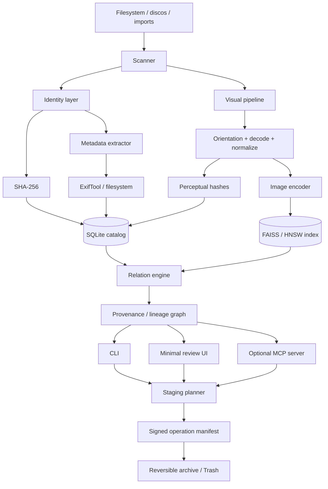

# Photo Custodian: arquitectura Linux-first para deduplicación, similitud visual y procedencia fotográfica

## Resumen ejecutivo

`annatchijova/photo-custodian` tiene sentido como proyecto propio aunque ya existan buenos deduplicadores y gestores fotográficos. El hueco interesante no es “encontrar fotos repetidas”: Czkawka ya combina duplicados exactos y perceptuales, digiKam mantiene fingerprints de similitud, PhotoPrism usa perceptual hashes e Immich implementa búsqueda semántica con CLIP. El espacio diferencial aparece al **unificar identidad criptográfica, similitud perceptual, embeddings visuales, reconstrucción de versiones, procedencia explícita y eliminación reversible**, con una interfaz CLI-first y sin necesidad de nube. citeturn944750search4turn944750search24turn944750search47turn944750search26

Mi recomendación es un **monolito modular en Python para la primera versión**, con SQLite como registro autoritativo, SHA-256 como identidad de contenido, `imagehash`/OpenCV para perceptual hashing, libvips para decodificación y normalización eficiente, ExifTool para metadata, y OpenCLIP o DINOv2 como capa opcional de similitud semántica. FAISS debería empezar como índice vectorial separado y reconstruible, no como fuente de verdad. Python ofrece acá una ventaja desproporcionada: permite validar arquitectura, thresholds, UX y modelo de datos antes de decidir qué componentes merecen migrar a Rust o C. `hashlib` incluye SHA-256; ImageHash implementa varios hashes perceptuales; OpenCV posee un módulo específico `img_hash`; FAISS está diseñado para búsqueda eficiente sobre vectores densos. citeturn266245search4turn897560search33turn266245search13turn266245search0

La separación epistemológica debería ser estricta:

```text
SHA-256              → identidad de bytes
perceptual hash      → evidencia de misma imagen transformada
visual embedding     → evidencia de similitud visual/semántica
metadata             → evidencia contextual
lineage inference    → hipótesis derivativa
delete/archive       → decisión explícita y reversible
```

Un embedding **no debería decidir qué borrar**. Tampoco un pHash. El sistema puede producir candidatos, agrupar evidencia y puntuar relaciones; la mutación del filesystem debería ser otra capa, con dry-run, staging, manifiesto y recuperación. Esa separación coincide además con tu preferencia documentada por núcleo determinístico, terminal primero y decisiones separadas de narración/modelos. fileciteturn0file1

Para unas **200.000 fotos** —cantidad no especificada por vos; la uso como escenario de dimensionamiento— 1 TB es perfectamente manejable sin infraestructura distribuida. Un embedding de 512 dimensiones en `float32` ocupa unos 390 MiB para 200k imágenes antes del overhead del índice; en `float16`, unos 195 MiB. Incluso 768 dimensiones permanecen en un rango de cientos de MiB. FAISS puede trabajar directamente con este volumen en una sola máquina, mientras HNSWlib aporta una alternativa ANN compacta y persistible. citeturn266245search0turn897548search0

La RTX 3090 sirve especialmente para el pase de embeddings, pero **Photo Custodian no debería requerir GPU**. Exact dedupe, perceptual hashing, metadata, provenance y revisión tienen que funcionar en CPU. La aceleración CUDA debe ser una optimización.

La primera release útil no necesita MCP, captioning ni una GUI compleja. Necesita hacer impecablemente cinco cosas: **scan → hash exacto → detectar near-duplicates → mostrar evidencia → stage/restore**.

## Objetivo, límites y arquitectura

El objetivo real no es “limpiar un disco”. Es construir un **catálogo local verificable de objetos fotográficos y relaciones entre ellos** que después pueda operar sobre dos computadoras, discos externos y eventualmente material proveniente del celular.

La propiedad fundamental debería ser que el índice pueda destruirse y reconstruirse desde los archivos y sus manifiestos. SQLite, FAISS, thumbnails y embeddings son derivados; las fotografías y los manifiestos son evidencia primaria.

Una arquitectura inicial razonable sería:



### Monolito modular frente a servicios

Para esta escala recomiendo **monolito modular**. Separar scanner, extractor EXIF, vector service, database service y agent service en procesos distintos agregaría despliegue, observabilidad y sincronización interna sin una necesidad real. El volumen de 200k imágenes está muy por debajo del tipo de escala donde un diseño distribuido sea obligado; FAISS está pensado incluso para conjuntos vectoriales muchísimo mayores. citeturn266245search0

Pero “monolito” no debería significar mezclar responsabilidades. El repositorio puede tener interfaces estables:

```text
photo_custodian/
    scanner/
    identity/
    metadata/
    perceptual/
    embeddings/
    index/
    provenance/
    operations/
    cli/
    mcp/
```

Esto deja abierta una evolución natural: si el scanner o hashing se convierten en cuello de botella, pueden migrarse a Rust sin tocar provenance o CLI.

### Modelo de datos

Yo modelaría cuatro entidades diferentes:

```text
file_instance
    machine_id
    filesystem_path
    inode/device cuando corresponda
    size
    mtime
    discovered_at

content_object
    sha256
    bytes
    mime
    decoder_status

visual_asset
    normalized perceptual hashes
    embedding model/version/vector
    width/height/orientation

relationship
    source_sha256
    target_sha256
    relation_type
    evidence
    score
    method_version
    status = proposed | confirmed | rejected
```

Esto evita un error común: confundir **archivo**, **contenido** e **imagen**. Dos rutas pueden apuntar al mismo contenido; dos contenidos distintos pueden representar la misma fotografía recomprimida; dos fotografías visualmente parecidas pueden no compartir ningún linaje.

Para lineage usaría un **grafo dirigido**, no un árbol. Una foto editada puede derivar de una original, recibir metadata de otra fuente o tener varias exportaciones; forzar un árbol inventaría relaciones inexistentes.

## Identidad, similitud visual y procedencia

### Duplicación exacta

SHA-256 es una buena identidad canónica. Python lo ofrece directamente mediante `hashlib`, y para archivos recientes existe incluso `hashlib.file_digest()`. citeturn266245search2turn266245search6

El scanner puede optimizar así:

```text
size
 ↓
grupos con tamaño repetido
 ↓
quick prefix/suffix hash opcional
 ↓
SHA-256 completo
 ↓
grupo exacto
```

Pero hay una decisión conceptual: si querés **content addressing real**, eventualmente todos los archivos deberían tener SHA-256 completo, incluso los únicos. El prehash solamente reduce I/O durante scans rápidos; no debería convertirse en identidad permanente.

También conviene detectar hardlinks mediante `(st_dev, st_ino)` para no confundir “dos nombres de la misma instancia física” con dos copias.

### Hashing perceptual

OpenCV implementa AverageHash, BlockMeanHash, ColorMomentHash, Marr-Hildreth, pHash y RadialVarianceHash; su documentación incluye comparación frente a alteraciones como blur, ruido, JPEG, watermark y resize. citeturn266245search3turn266245search13

`ImageHash` ofrece una API Python más cómoda y una licencia BSD-2-Clause. citeturn897560search17turn897560search33

No elegiría un solo hash. Guardaría al menos:

```text
pHash      → robustez ante compresión / resize
dHash      → cambios estructurales simples
wHash      → otra señal multiescala
color hash → información cromática
```

La distancia de Hamming es la comparación natural para hashes binarios. El proyecto pHash documenta este enfoque e incluso publicó thresholds experimentales, pero esos valores dependen del algoritmo y del corpus; por ejemplo, el diseño histórico de pHash cita `T=22` para su hash DCT particular. No trasladaría ese número sin calibración a ImageHash u OpenCV. citeturn446943search15turn446943search23

Como **heurística inicial para pHash de 64 bits**, no como norma universal:

| Hamming | Tratamiento propuesto |
|---:|---|
| 0–4 | candidato muy fuerte a misma imagen transformada |
| 5–10 | probable near-duplicate |
| 11–16 | revisar junto con embedding/metadata |
| >16 | no agrupar automáticamente |

La release debería incluir un corpus de calibración propio: original → resize, JPEG 70/85/95, crop, rotation, watermark, color correction, screenshot, re-encode HEIC/JPEG. De ahí salen ROC/precision-recall y thresholds versionados. Eso es mucho más defendible que copiar un número de Stack Overflow.

### Embeddings visuales

Para **misma escena con transformaciones fuertes**, bursts y agrupación semántica, agregaría embeddings después del hashing perceptual.

La primera opción práctica es [OpenCLIP](https://github.com/mlfoundations/open_clip). Es una implementación abierta de CLIP con numerosos checkpoints y actualmente mantiene una línea 4.x; puede cargar modelos desde Hugging Face. citeturn705636search5turn897560search11

Un checkpoint razonable para empezar es [LAION CLIP ViT-B/32](https://huggingface.co/laion/CLIP-ViT-B-32-laion2B-s34B-b79K), que OpenCLIP puede cargar directamente. citeturn446943search0turn446943search1

También evaluaría [DINOv2](https://github.com/facebookresearch/dinov2), porque produce features visuales sin necesitar texto y está pensado precisamente como backbone generalista de representación visual. Su código y modelos se publican bajo Apache-2.0 según el repositorio actual. citeturn705636search6turn897560search7

En noviembre de 2026 existe además [DINOv3](https://github.com/facebookresearch/dinov3), continuación más reciente de esa familia, pero su licencia ya no es simplemente Apache: el paquete declara una licencia DINOv3 específica. Por eso no lo metería por defecto hasta revisar compatibilidad exacta con la licencia que elijas para Photo Custodian. citeturn446943search2turn446943search5turn446943search26

Para búsqueda texto→foto, SigLIP/OpenCLIP es más natural que DINOv2. Para relaciones puramente imagen→imagen, compararía ambos empíricamente.

**LLaVA, Qwen-VL/Gemma multimodal o captioners no deberían estar en el camino crítico.** Captioning sirve para:

```text
“foto de Lucy en el patio”
“captura de pantalla con terminal”
“documento fotografiado”
```

pero no mejora la identidad exacta y puede introducir descripciones falsas. Lo pondría como módulo opcional, asincrónico y regenerable.

Los modelos de lenguaje locales que ya tengas —Qwen, Gemma, Hermes— pueden servir después para interpretar clusters, sugerir etiquetas o responder consultas sobre metadata; no los usaría como encoder visual principal.

### Reproducibilidad de embeddings

Para poder reconstruir resultados, cada embedding debería almacenar:

```json
{
  "model": "...",
  "checkpoint_sha256": "...",
  "library_version": "...",
  "preprocess_spec": "...",
  "decoder": "...",
  "device": "cuda|cpu",
  "dtype": "float32|float16",
  "normalization": "...",
  "embedding_dim": 512
}
```

No trataría el vector flotante como evidencia criptográfica. Incluso con semillas fijadas pueden existir diferencias numéricas entre hardware/backends. El SHA-256 del archivo sigue siendo identidad; la embedding es una observación derivada.

Para tests de reproducibilidad, usaría un pequeño corpus golden en CPU `float32`, y tolerancias explícitas para GPU.

## Eliminación segura, metadata, sincronización y privacidad

### Metadata y provenance

ExifTool es difícil de superar para cobertura de formatos y tags; su documentación mantiene una tabla enorme de metadata y puede leer/escribir múltiples familias de formatos. Al escribir metadata, además preserva por defecto el original con sufijo `_original`, una filosofía compatible con Photo Custodian. citeturn705636search0turn705636search1turn705636search2

Guardaría **metadata cruda + metadata normalizada**:

```text
raw_exif_json
capture_time
timezone/status
camera_make/model
lens
gps
orientation
software
image_unique_id
filesystem_birth/mtime
```

No usaría `mtime` como prueba de fecha de captura ni como criterio suficiente de lineage.

Las relaciones deberían distinguir:

```text
BYTE_IDENTICAL
LIKELY_REENCODE
LIKELY_RESIZE
LIKELY_CROP
LIKELY_EDIT
BURST_NEIGHBOR
VISUALLY_SIMILAR
UNKNOWN_RELATION
```

y guardar **por qué**:

```json
{
  "phash_distance": 3,
  "clip_cosine": 0.987,
  "capture_delta_seconds": 0,
  "dimensions": ["4032x3024", "2016x1512"],
  "software_changed": true
}
```

Eso permite revisar una inferencia meses después.

### Staging en vez de borrar

La UX más segura sería:

```text
scan
→ propose
→ review
→ stage
→ commit
→ optionally purge later
```

Nunca:

```text
scan → rm
```

Linux ya tiene una especificación interoperable para Trash que define cómo almacenar, listar y restaurar archivos descartados. Conviene apoyarse en ella antes de inventar una papelera propia. citeturn705636search10

Además mantendría un manifiesto de operación:

```json
{
  "operation_id": "...",
  "created_at": "...",
  "machine_id": "...",
  "items": [
    {
      "sha256": "...",
      "old_path": "...",
      "new_path": "...",
      "reason": "BYTE_IDENTICAL",
      "keeper_sha256": "..."
    }
  ],
  "manifest_sha256": "..."
}
```

Opcionalmente podés agregar firma Ed25519. El valor no es “seguridad militar”: es poder demostrar que el manifiesto de una operación no fue alterado después.

Una GUI mínima debería mostrar **keeper + candidatos lado a lado**, zoom sincronizado, metadata crítica, razón de agrupamiento y selección explícita. Czkawka ya demuestra el valor de previews para similares; dupeGuru trabaja con grupos y referencias. citeturn944750search2turn944750search22

### Dos computadoras y conectividad intermitente

No intentaría sincronizar la base SQLite viva entre máquinas.

Cada equipo debería tener:

```text
machine UUID
local catalog
local filesystem observations
shared content IDs
exportable manifests
```

Después podés fusionar catálogos por SHA-256.

Para sincronización de archivos:

- [Syncthing](https://syncthing.net/) es apropiado si querés carpetas replicadas entre equipos; soporta versionado de archivos recibidos y filesystem watching. Importante: su versionado protege cambios recibidos desde otros nodos, no necesariamente cambios locales del propio nodo. citeturn705636search7turn705636search8
- [git-annex](https://git-annex.branchable.com/) merece estudio serio para el caso más archivístico: administra grandes archivos fuera del objeto Git, registra dónde existen, usa checksums y está diseñado también para flujos offline. citeturn705636search9
- `rsync` sigue siendo excelente como transporte explícito, pero no lo usaría como sistema de provenance.

Mi preferencia sería **Photo Custodian no sincroniza bytes en v1**. Exporta/ingiere catálogos y deja el transporte a Syncthing, rsync o git-annex.

### MCP y agentes

Un MCP tendría valor cuando el core ya sea estable:

```text
find_duplicates(path)
find_similar(image_id, threshold)
explain_group(group_id)
propose_cleanup(group_id)
get_manifest(operation_id)
```

No expondría inicialmente:

```text
delete_file()
purge_trash()
```

La especificación MCP vigente a noviembre de 2026 es la `2026-07-28`, con core stateless y cambios de autorización; existen SDK oficiales tanto Python como Rust. citeturn275635search1turn275635search0turn275635search5turn275635search6

El agente puede investigar y proponer. La mutación debería pasar por el mismo planificador determinístico que usa la CLI.

### Privacidad

Por defecto:

```text
network = denied
telemetry = none
model downloads = explicit
remote inference = disabled
GPS display = opt-in
```

Los embeddings también son información sensible: no son una copia reversible trivial de la foto, pero representan contenido visual y pueden permitir búsquedas semánticas. Los trataría como datos privados.

Para cifrado at-rest, confiaría preferentemente en cifrado de disco/sistema y no en criptografía casera dentro de la aplicación.

## Tecnologías, rendimiento y elección de stack

### Comparación de stacks

| Stack | Ventajas | Desventajas | Velocidad de desarrollo | Runtime | Reproducibilidad | Ecosistema |
|---|---|---|---|---|---|---|
| **Python + SQLite + FAISS** | ML, EXIF, imágenes, CLI y prototipado excelentes; CUDA sencillo | GIL y packaging ML pesado | **Muy alta** | Alta; partes críticas ya nativas | Buena si fijás versiones/modelos | **Excelente** |
| **Rust + sled + HNSWlib** | scanner seguro/rápido; binario fuerte; concurrencia | FFI con HNSWlib C++; ML menos cómodo; `sled` agrega otra decisión de storage | Media-baja | **Muy alta** | Muy buena en core | Buena, peor para visión |
| **C/Rust core + Python bindings** | hot path nativo + ecosistema ML Python | dos toolchains, bindings, ABI/testing | Media | **Excelente** | Muy buena | **Excelente** |
| **C puro + libvips** | mínimo overhead, control total, libvips muy eficiente | mucho código propio; ML/vector search y ergonomía más costosos | Baja | **Excelente** | Excelente en operaciones determinísticas | Limitado para ML |

FAISS es MIT; HNSWlib es Apache-2.0; ImageHash usa BSD-2-Clause; OpenCLIP declara MIT; libvips LGPL-2.1-or-later. Es una combinación bastante cómoda para un proyecto open source, aunque siempre habría que auditar también las licencias individuales de los **pesos de modelos**, no solamente las bibliotecas. citeturn897560search0turn897560search4turn897560search17turn897560search11turn897560search37

**Elegiría stack 1 ahora y diseñaría para poder llegar al 3.**

No empezaría escribiendo hashing o decoders en C. `hashlib`, libvips, OpenCV, FAISS y PyTorch ya ejecutan la mayor parte del trabajo pesado en código nativo.

### FAISS, HNSWlib y Annoy

FAISS soporta búsquedas sobre vectores densos y tiene implementación GPU; para 200k imágenes incluso un índice exacto puede ser razonable. citeturn266245search0turn266245search1

HNSWlib es una biblioteca C++ header-only con bindings Python y permite controlar semilla aleatoria de construcción; es atractiva si priorizás índice ANN persistente y simple. citeturn897548search0turn897548search29

Annoy sigue siendo válido para índices estáticos mapeables desde disco, pero para este proyecto lo pondría detrás de FAISS/HNSWlib porque los catálogos van a cambiar y querés experimentar con varias métricas. Su diseño está orientado a ANN en C++ con bindings y persistencia en disco. citeturn897548search2

### libvips frente a OpenCV

Usaría **libvips para ingest/resize/thumbnails** y OpenCV únicamente donde sus algoritmos aporten algo concreto. libvips es demand-driven, multithreaded y está específicamente diseñado para mantener bajo consumo de memoria al procesar imágenes grandes. citeturn705636search3turn705636search4

### Estimación para 1 TB / 200k fotos

Esto es **dimensionamiento de ingeniería, no benchmark medido de tu máquina**.

Supuestos:

```text
SSD efectivo secuencial:       300–800 MB/s
fotos:                         ~200.000
embedding:                     512–768 dimensiones
GPU:                           RTX 3090
CPU fallback:                  sin asumir modelo concreto
```

Leer físicamente 1 TB una sola vez tiene un piso teórico aproximado de:

```text
1 TB / 800 MB/s ≈ 21 min
1 TB / 500 MB/s ≈ 33 min
1 TB / 300 MB/s ≈ 56 min
```

Por eso el SHA-256 completo de todo el corpus probablemente sea principalmente I/O-bound en un SSD razonable. Decodificar 200k fotografías para pHash o embeddings es otra operación y no debería mezclarse con ese número.

Como presupuesto inicial, no como promesa:

| Etapa | RTX 3090 | CPU-only |
|---|---:|---:|
| scan + metadata | decenas de minutos | similar |
| SHA-256 de 1 TB | ~30–90 min | ~30–120 min |
| pHash thumbnails | ~10–60 min | ~15–90 min |
| 200k embeddings compactos | ~20–90 min | ~4–20 h |
| construir índice 200k | minutos | minutos |
| scans incrementales posteriores | sólo archivos cambiados | sólo archivos cambiados |

La enorme reducción en scans posteriores sale de cachear `size + mtime + inode/device + sha256` y no volver a decodificar objetos cuyo estado no cambió.

### Tamaño de índices

Para 200k fotos:

```text
512-d float32 = 200000 × 512 × 4
              ≈ 409.6 MB decimal

768-d float32 ≈ 614.4 MB

512-d float16 ≈ 204.8 MB
```

SQLite con paths, hashes, metadata normalizada, relaciones e índices debería seguir siendo pequeño comparado con el TB de originales; el tamaño exacto dependerá sobre todo de cuánto EXIF JSON y thumbnails decidas persistir.

## Ecosistema a estudiar y roadmap

### Proyectos que vale la pena destripar

**[Czkawka](https://github.com/qarmin/czkawka)** probablemente sea el repositorio más importante para estudiar primero. Está en Rust, separa core y frontends, encuentra duplicados exactos y similares, mantiene caches de hashes y tiene soporte explícito para perceptual hashes. No lo clonaría conceptualmente entero; sí estudiaría scanner, caching y ergonomía de grupos. citeturn944750search1turn944750search4turn944750search10

**[digiKam](https://www.digikam.org/)** merece estudio por su modelo de biblioteca fotográfica y fingerprints. Su manual en español documenta búsqueda por similitud y duplicados. citeturn944750search32turn944750search36

**[PhotoPrism](https://www.photoprism.app/)** es relevante por stacking, perceptual hashes y gestión fotográfica self-hosted. citeturn944750search47turn944750search48

**[Immich](https://immich.app/)** es el referente para estudiar búsqueda semántica moderna: usa CLIP para smart search y permite configurar su capa ML. citeturn944750search26turn944750search28

**[dupeGuru](https://github.com/arsenetar/dupeguru)** sirve para estudiar UX de grupos y matching fuzzy. citeturn944750search5turn944750search22

**[rmlint](https://rmlint.readthedocs.io/)** tiene una idea especialmente buena: antes de ejecutar eliminación puede volver a verificar que los duplicados sigan siendo idénticos. Photo Custodian debería copiar ese principio de **revalidation-at-commit**. citeturn944750search39

También encontré un proyecto reciente llamado [Photo Curator](https://github.com/kotyzap/Photo-Curator) que combina procesamiento local, dedup perceptual y operaciones reversibles, y otro proyecto del mismo nombre que explícitamente separa SHA-256, perceptual hash y CLIP en tres pases. No los tomaría como autoridad arquitectónica, pero son competidores comparables que conviene estudiar para no reinventar UX evidente. citeturn754790search0turn754790search4

### Roadmap priorizado

```mermaid
gantt
    title Photo Custodian — esfuerzo orientativo
    dateFormat  X
    axisFormat %s

    section Core
    Scanner + SQLite + schema          :a1, 0, 2
    SHA-256 + exact groups             :a2, after a1, 1
    Metadata + thumbnails              :a3, after a1, 1

    section Safety
    Planner + dry-run                  :b1, after a2, 1
    Trash + restore manifests          :b2, after b1, 1

    section Visual
    pHash + calibration corpus         :c1, after a3, 2
    Review groups                      :c2, after c1, 1
    Embeddings + FAISS                 :c3, after c1, 2

    section Provenance
    Lineage evidence graph             :d1, after c3, 2

    section Extensions
    Multi-machine catalog merge        :e1, after d1, 2
    MCP read/propose tools             :e2, after d1, 1
```



Las unidades del gráfico son **bloques relativos de esfuerzo**, no fechas.

Mi secuencia concreta sería:

**Release inicial — 30–50 horas efectivas.** Scanner incremental, SQLite, SHA-256, exact duplicate groups, ExifTool, CLI, dry-run, Trash, restore y manifests. Nada de ML.

**Perceptual — +20–35 h.** Normalización EXIF orientation, pHash/dHash/wHash, corpus sintético de transformaciones, thresholds medidos y review interactivo.

**Semantic — +20–40 h.** OpenCLIP o DINOv2, batching CUDA/CPU, FAISS, búsqueda imagen→imagen y clustering candidato.

**Provenance — +25–50 h.** Grafo de relaciones, evidencia, confirm/reject, export JSON y reconstrucción de versiones.

**Multi-machine — +15–30 h.** machine IDs, export/import de catálogo, merge por SHA-256 y reportes de ubicación.

**MCP — +8–20 h.** herramientas read-only y proposal-first. No borrado autónomo.

No haría GUI completa, captioning, face recognition ni sync propio antes de que el core esté estabilizado.

### Packaging y CI

Para Linux Mint, priorizaría:

```text
1. uv/pipx o wheel
2. .deb
3. Flatpak si aparece GUI
4. container sólo para desarrollo/ML reproducible
5. Snap opcional, no prioritario
```

Debian mantiene documentación activa de packaging y un `.deb` encaja naturalmente con Mint. citeturn897548search3turn897548search22

Docker puede exponer GPU mediante `--gpus`, por lo que es útil para CI manual o reproducir el stack CUDA, pero **no lo impondría al usuario final** de una herramienta que necesita interactuar profundamente con mounts y Trash del escritorio. citeturn897548search10turn897548search39

CI:

```text
ruff / mypy
pytest
golden metadata fixtures
golden perceptual transformations
SQLite migration tests
manifest round-trip tests
restore tests
property tests para paths
CPU embedding reproducibility test
optional GPU workflow
```

Tus instrucciones de trabajo además indican artefactos de repo en inglés, terminal primero y verificación contra código vivo, así que README, CLI help, tests y schema deberían quedar en inglés aunque la discusión de diseño sea en español. fileciteturn0file1

## CLI y prototipo mínimo

La CLI debería ser aburridamente explícita.

```bash
photo-custodian init ~/Pictures
```

```bash
photo-custodian scan ~/Pictures --metadata --sha256
```

```bash
photo-custodian duplicates exact
```

```bash
photo-custodian duplicates perceptual --max-distance 8
```

```bash
photo-custodian similar ~/Pictures/example.jpg --top 30
```

```bash
photo-custodian lineage show sha256:abc123...
```

```bash
photo-custodian plan dedupe --group grp_0182 --keep best-resolution
```

```bash
photo-custodian plan inspect op_20261109_001
```

```bash
photo-custodian apply op_20261109_001 --revalidate
```

```bash
photo-custodian restore op_20261109_001
```

Y el comando que considero importante que exista desde muy temprano:

```bash
photo-custodian verify
```

Ese comando debería recorrer base, manifests y filesystem e informar inconsistencias sin modificar nada.

### Prototipo Python mínimo

Este ejemplo calcula **SHA-256**, un **pHash** y un embedding OpenCLIP completamente local una vez que el checkpoint ya está descargado. `hashlib` proporciona SHA-256; ImageHash implementa pHash y OpenCLIP permite crear modelo y transforms desde un checkpoint compatible. citeturn266245search2turn897560search33turn446943search0

```python
from __future__ import annotations

import hashlib
from pathlib import Path

import imagehash
import open_clip
import torch
from PIL import Image


MODEL_ID = "hf-hub:laion/CLIP-ViT-B-32-laion2B-s34B-b79K"


def sha256_file(path: Path, chunk_size: int = 8 * 1024 * 1024) -> str:
    digest = hashlib.sha256()

    with path.open("rb") as fh:
        while chunk := fh.read(chunk_size):
            digest.update(chunk)

    return digest.hexdigest()


def perceptual_hash(path: Path) -> str:
    with Image.open(path) as image:
        image = image.convert("RGB")
        return str(imagehash.phash(image))


def load_encoder(device: str):
    model, _, preprocess = open_clip.create_model_and_transforms(MODEL_ID)
    model = model.to(device)
    model.eval()
    return model, preprocess


@torch.inference_mode()
def image_embedding(
    path: Path,
    model,
    preprocess,
    device: str,
) -> list[float]:
    with Image.open(path) as image:
        image = image.convert("RGB")
        tensor = preprocess(image).unsqueeze(0).to(device)

    vector = model.encode_image(tensor)
    vector = vector / vector.norm(dim=-1, keepdim=True)

    return vector.squeeze(0).cpu().float().tolist()


def inspect(path: Path) -> dict:
    device = "cuda" if torch.cuda.is_available() else "cpu"
    model, preprocess = load_encoder(device)

    return {
        "path": str(path),
        "sha256": sha256_file(path),
        "phash": perceptual_hash(path),
        "embedding_model": MODEL_ID,
        "embedding": image_embedding(
            path,
            model=model,
            preprocess=preprocess,
            device=device,
        ),
    }


if __name__ == "__main__":
    import json
    import sys

    result = inspect(Path(sys.argv[1]))
    print(json.dumps(result, indent=2))
```

Para producción cambiaría varias cosas inmediatamente: modelo cargado una sola vez por proceso, batching de imágenes, EXIF orientation antes de pHash/embedding, libvips para thumbnails, manejo explícito de archivos corruptos, checkpoint previamente fijado por digest, cache incremental y almacenamiento binario de vectores en vez de JSON.

La decisión de arquitectura que dejaría escrita en `ARCHITECTURE.md` desde el primer commit sería ésta:

> **Photo Custodian never infers deletion from similarity. Identity, similarity, provenance and filesystem mutation are separate layers.**

Eso convierte el proyecto en algo bastante más serio que otro buscador de duplicados: un sistema local de **custodia, evidencia y transformación reversible de una colección visual**.