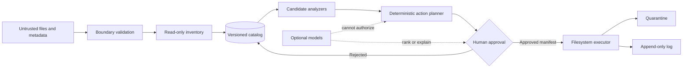
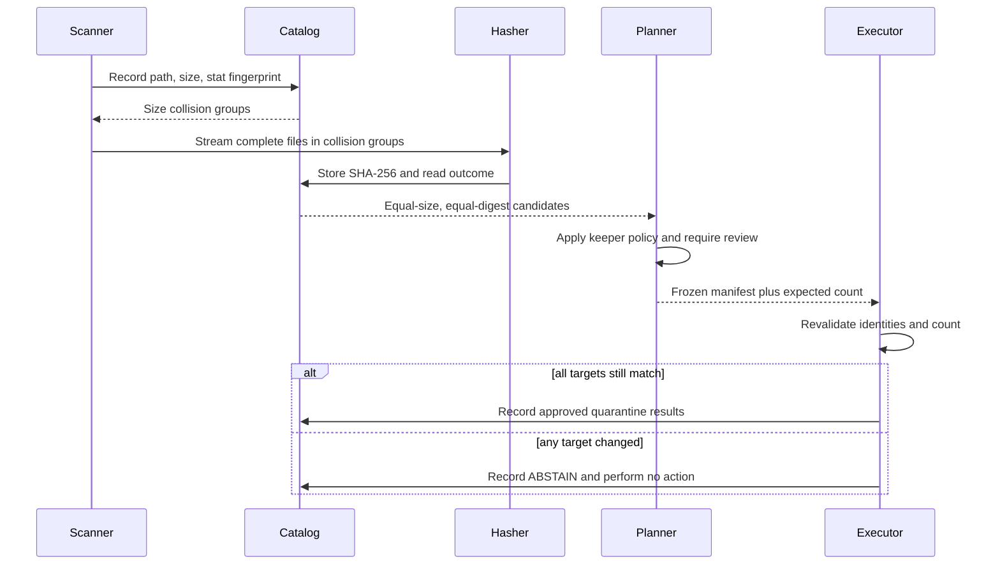

[English overview](../README.md) · [Resumen en español](../README_ES.md) · **Technical README**

# Photo Custodian: Technical Design

This document records the architecture and engineering constraints for Photo
Custodian. M0 read-only inventory and M1 exact duplicate detection are
implemented; quarantine, similarity analysis, and model integration remain design
proposals.

## System boundary

The system inventories photo and video collections exposed as local Linux
filesystem paths. Remote services and phones enter through explicit staging or
read-only mounts. The first implementation targets a single user and a local
SQLite catalog.

The system does not initially promise:

- automatic selection of the aesthetically best photograph;
- unattended permanent deletion;
- cloud synchronization;
- identity or face recognition;
- adversarial robustness of perceptual similarity;
- transactionality across independent filesystems.

## Classification contract

| Class | Evidence | Permitted automatic conclusion |
|---|---|---|
| Exact duplicate | Equal byte length and SHA-256 digest | Files contain identical bytes |
| Visual variant | Perceptual distance and/or embedding distance | Human review is warranted |
| Related asset | Metadata and sidecar relationship rules | Assets should be presented together |
| Quality candidate | Explicit quality measurement | Human review is warranted |
| Unknown | Missing decoder, metadata error, or incomplete scan | No destructive action |

An exact-byte conclusion does not establish that a path is disposable. A copy
may intentionally provide redundancy or belong to a separate archival policy.

## Trust boundaries

Inputs, EXIF data, image decoders, mounted filesystems, model outputs, and MCP
clients are untrusted. The action planner accepts typed catalog records and
explicit human decisions, never raw model prose.

## Core invariants

1. **Observation before mutation.** Scanning cannot call mutation operations.
2. **Stable identity.** Catalog identity combines source identity, path bytes,
   stat information, and content digest state without treating a mutable path as
   permanent identity.
3. **Hash before exactness.** No file is labeled exact from name, timestamp,
   dimensions, or a partial digest.
4. **No model authority.** Model output cannot change an action from denied to
   allowed.
5. **Explicit target set.** An action plan freezes file identities and expected
   counts before execution.
6. **Time-of-check validation.** The executor re-stats and, where required,
   re-hashes a target before mutation.
7. **Reversible default.** Approved removals move to quarantine with a manifest;
   permanent purge is a later operation.
8. **Honest uncertainty.** Unsupported formats, unavailable optional components,
   incomplete scans, and changed files produce WARN or ABSTAIN, never PASS.
9. **Independent recovery.** A quarantine on the same disk is an undo mechanism,
   not a backup.
10. **Auditable execution.** Every mutation records its plan, result, and
    verification without including model-generated prose in the consequential
    record.

## Exact duplicate pipeline

The implementation may use faster non-cryptographic or partial hashes only as
prefilters. The final exactness claim always depends on a complete cryptographic
digest.

## Mutation protocol

Each action plan should contain:

- a versioned plan schema;
- immutable catalog IDs and original paths;
- file size, digest, and expected filesystem fingerprint;
- selected keeper and policy rationale;
- expected target count stated before execution;
- source and quarantine filesystem identities;
- creation time outside any deterministic decision payload;
- approval identity and time;
- per-target execution and post-verification result.

Cross-filesystem moves degrade to copy, verify, and source removal. If the copy
or verification fails, the source remains. A partial batch must be resumable and
must report its mixed state rather than claiming success.

## Language decision

### Problem shape

The initial system is filesystem orchestration, metadata extraction, local data
management, image analysis experimentation, and a human review workflow. Its
dominant constraint is safety and inspectability rather than a measured CPU
bottleneck.

### Initial choice

**Python** is the proposed orchestration language and **SQLite** the catalog
engine.

Python entered the search because its standard library covers filesystem access,
SHA-256, SQLite, structured CLI work, and exact arithmetic, while its imaging and
ML ecosystems reduce the cost of evaluating perceptual methods. SQLite provides
transactions, indexes, schema migration support, and a portable single-user
artifact.

The guarantees do not come from Python alone. Runtime validation, explicit data
types at boundaries, transaction design, locked dependencies, and behavioral
tests remain necessary.

### Rivals

- **Rust** offers memory safety, native performance, and strong type modeling.
  Its strongest case is a future scanner operating at measured scale or a
  reusable core integrated with Czkawka. It currently loses on iteration cost and
  ML ecosystem integration before a bottleneck has been demonstrated.
- **Go** offers a simple static binary and straightforward concurrency. Its
  strongest case is distribution across multiple machines. It currently loses on
  image-analysis experimentation and would not remove the need for a separate ML
  boundary.
- **Rust plus Python** may become justified if profiling isolates hashing,
  decoding, or traversal as a meaningful bottleneck. Until then, the extra FFI or
  process boundary is an accepted reason not to split the implementation.

Reopen the choice when a representative corpus benchmark shows that the proposed
Python pipeline cannot meet an agreed scan-time or memory budget, or when a
dependency required for safe decoding exists only behind a different runtime.

## Optional MCP and model boundary

The MCP server is an adapter, not an authority. Candidate read-only tools include
`scan_status`, `list_groups`, `get_group_evidence`, and `render_comparison`.
Mutation tools, if ever added, must accept a previously approved manifest and may
not convert free-form model output into file targets.

Ollama or another local model may explain visible differences or summarize fixed
group evidence. Swapping or disabling the model must not change exact duplicate
groups, keeper decisions, action manifests, or audit results.

## Catalog and schema evolution

The catalog schema must be versioned and migrated forward explicitly. Derived
data records include the tool and algorithm version that produced them. Changing
a perceptual model or threshold invalidates the associated derived candidates,
not the underlying file inventory.

Timestamps, random identifiers, and machine-local paths must not enter any digest
used to claim deterministic equivalence unless their inclusion is explicitly
part of a versioned schema.

## Failure states

| Condition | Required state | Destructive action |
|---|---|---|
| Source changes during hashing | WARN / rescan required | Denied |
| Image decoder unavailable | WARN / unsupported | Denied |
| Optional embedding model unavailable | WARN / visual feature disabled | Exact pipeline remains available |
| Catalog write fails after analysis | WARN / in-memory result not persisted | Denied until persisted and reviewed |
| Quarantine destination is full | FAIL with partial-state report | Stop; preserve sources |
| Expected and actual target counts differ | ABSTAIN | Denied |
| Restore has not been tested | WARN: recovery unproven | Permanent purge denied |

## Verification plan

The implementation must provide evidence for the property it claims:

- unit tests for classification rules and schema validation;
- fixture-based tests for EXIF, HEIC, RAW, sidecars, and malformed input;
- repeated-run tests that produce identical exact groups from identical inputs;
- reordered traversal tests to expose ordering dependence;
- mutation tests that change a target between plan and execution;
- full quarantine and restore integration tests on same and different
  filesystems;
- fault injection for full disks, permission failures, interrupted batches, and
  catalog locks;
- labeled-corpus precision and recall measurements before selecting visual
  thresholds;
- an end-to-end test proving that swapping the optional model changes only prose.

M0 has behavioral tests for schema stamping, boundary rejection, symlink
skipping, incremental fingerprints, missing-file state, inventory aggregation,
and CLI error handling. M1 adds migration, complete SHA-256, hardlink, stale-file,
cache, traversal-order, bounded-output, and CLI tests. No representative
one-terabyte benchmark or evidence for later milestones exists yet; claims about
those capabilities remain design-only.

## Dependency and operational constraints

- Dependencies will be locked and their execution authority reviewed.
- New image decoders are treated as parsers of hostile input.
- Scans must be resumable and bounded in memory for a one-terabyte collection.
- Network access is off by default for the core pipeline.
- Logs must avoid image contents and sensitive metadata unless explicitly
  requested for diagnosis.
- The catalog, manifests, and audit trail require their own backup and tested
  restore procedure.

## Open decisions

- Canonical path-byte representation across Linux filesystems.
- Quarantine layout and behavior when source and destination differ.
- Keeper policy precedence: archival root, resolution, metadata richness, format,
  and user pinning.
- Initial perceptual hash and embedding candidates.
- Thumbnail privacy and cache lifetime.
- Whether Czkawka is invoked as an external engine, integrated through Rust, or
  used only as a comparative baseline.
- CLI/TUI framework and the minimum review interface for the first usable release.
